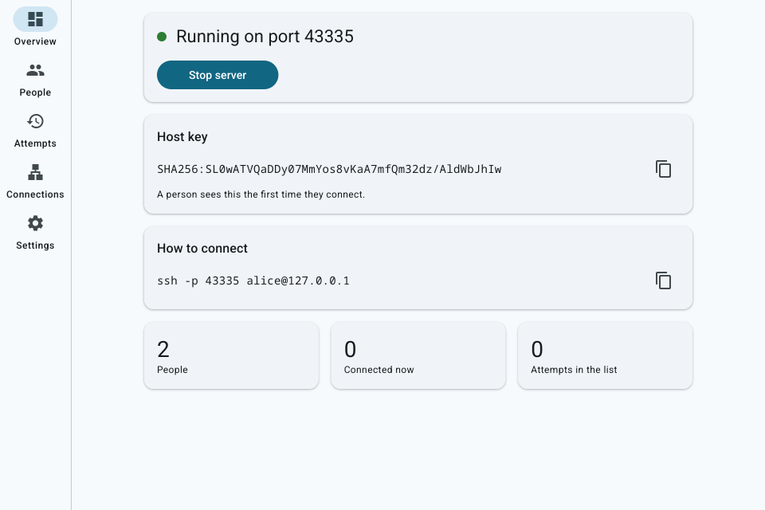

# Cave

Cave is an SSH server that you start, watch and stop yourself. It does the job of `sshd`, but it is an ordinary program: it needs no root, and every person who connects gets a session that runs as **you**. You open it, add the people you trust and the public keys they connect with, and see who tried to connect and how many times. When you are done, you close it.

It is for people who want to give a friend, a colleague or their own other computer a shell or a file transfer for a while, without setting up a system service. It runs on Linux and on Windows 10 (version 1809) or newer.

There are two programs, with the same features:

- `cave`, a desktop application (with a tray icon and notifications);
- `tcave`, an application for the terminal.



The terminal application looks like [this capture](docs/implemented-proof-images/5.3-overview.txt).

## Install

With Go (1.27 or newer):

```
go install github.com/rm4n0s/cave/cmd/cave@latest
go install github.com/rm4n0s/cave/cmd/tcave@latest
```

Or take the files of a release, if the author published them: an archive for Linux or Windows with both programs. Cave needs no installation beyond that, and no C compiler.

## First use

1. **Open it.** Run `cave` (or `tcave`). The server does not start by itself: the Overview page says it is stopped.
2. **Add a person with a key.** Go to the People page and add a name, such as `alice`: the name the person types before the `@` in `ssh alice@your-computer`. Ask the person for their *public* key: the file that ends in `.pub`, usually `~/.ssh/id_ed25519.pub`, and paste its text with the name. Cave adds nobody without a key. Never ask for the private key (the file without `.pub`): Cave refuses it.
3. **Start the server.** Press Start on the Overview page. It listens on port 2222. (Turn on "Start when Cave starts" in Settings if you want it to start by itself.)
4. **Give them the `ssh` line.** The Overview page shows how to connect, for example `ssh -p 2222 alice@192.168.1.20`. Send it to the person. Your computer must be reachable by them (the same network, or a port opened on your router).
5. **Watch the Attempts page.** Every connection to Cave's port is listed there, with who it was, where from, what came of it and how many times. A person who is turned away shows why.

## Security in short

- **Public keys only.** There are no passwords. A person gets in only when their name is one you added and they prove a key that you gave to that name.
- **Every session runs as you.** A person who is connected can do what you can do on this computer: read and change your files, run your programs, use your network. There is no sandbox, and people are not kept apart from each other. Add only people you would trust with your own account.
- A connected person may also copy files (SFTP), forward ports, and forward their SSH agent. You can turn each of these off in Settings.
- Cave does not run as root unless you tell it to, and it is not a replacement for a firewall.

Read [docs/SECURITY.md](docs/SECURITY.md) for what Cave does and does not protect, and [docs/GUIDE.md](docs/GUIDE.md) for everything else: people and keys, the settings, the files Cave keeps, the command line, Windows, and what to do when something goes wrong.

## License

BSD 3-Clause, see [LICENSE](LICENSE).
