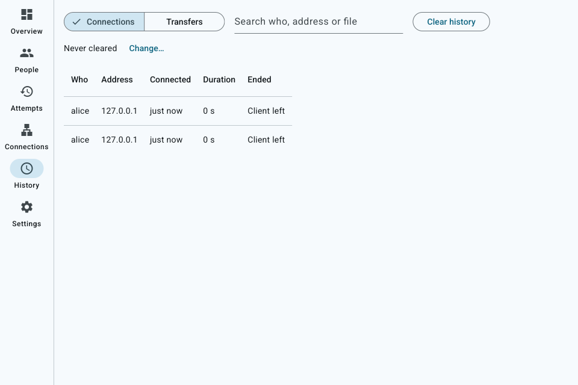

# Cave: Implemented steps

One entry per finished step of `docs/IMPLEMENTATION.md`, newest last. Format:

```
## Step <id>: <title>
- **Date**: YYYY-MM-DD
- **Branch**: feat/step-<id>-<slug>
- **Summary**: what was built, in two or three lines
- **Decisions**: choices the step made that the spec did not (and the spec section updated), or "none"
- **Checks**: the result of each check of rule 10 (passed, or skipped and why)
- **Tests**: what the tests cover; for OpenSSH and Wine tests, what ran and what was skipped
- **Proof**: the files, embedded or linked, or "none"
- **Manual checks**: "none", or "pending, see docs/MANUAL-CHECKS.md"
- **Glutter issues**: "none", or the new entries of docs/GLUTTER-ISSUES.md
```

---

## Step 0.1: The module and the checks
- **Date**: 2026-11-24
- **Branch**: feat/step-0.1-module
- **Summary**: The module `github.com/rm4n0s/cave` with `github.com/rm4n0s/errors`; `app.Version()`; `cmd/cave` and `cmd/tcave`, which print their version for `--version` and otherwise say they are not built yet; the linter's configuration; `scripts/heavy.sh` and `scripts/checks.sh`.  The TUI program was named `cave-tui` in this step and renamed `tcave` right after (the user, 2026-11-24).
- **Decisions**: a usage mistake exits with status 2 and any other error with 1. `scripts/checks.sh --no-wine` leaves the Wine run out while working (never to finish a step).
- **Checks**: `scripts/checks.sh` passed: gofmt, vet (Linux and Windows), golangci-lint (0 issues), race tests as a debug build, cgo-free build and tests, the Windows build. The error-tag check and the Wine run are skipped until steps 0.2 and 0.5 add their scripts.
- **Tests**: `versionFrom` on release tags, pseudo-versions and development builds; `run` of both programs for `--version`, an unknown flag, an unexpected argument, a closed output stream and no flag, each error by its route.
- **Proof**: none
- **Manual checks**: none
- **Glutter issues**: none

## Step 0.2: Architecture tests and the error-tag tool
- **Date**: 2026-11-24
- **Branch**: feat/step-0.2-archtest
- **Summary**: `internal/archtest` parses the module's Go files (every platform's, without building them) and checks rules 1–6 and 8 of SPEC §4.2 (`CheckBoundaries`) and rule 7 (`ScanTags`): every error Tag, where it is created, and whether a test asserts it. `internal/archtest/cmd/errortags` and `scripts/error-tags.sh` print the Tags and the untested ones. Two tests run both over Cave itself, so `go test ./...` fails on a broken boundary or an untested Tag.
- **Decisions**: SPEC §4.2 rule 7 now also says that a Tag is created at one place only (the versions of one function in different platforms' files may share one) and that no error is created outside a function; the tool reports both. Following that, the two usage errors of `cave`, `tcave` and `errortags` got a Tag each (`…Usage`, `…UnexpectedArgument`/`…RootMissing`). A route contains the frames of library functions between Cave's own (`fs.WalkDir`), so tests of such errors assert the route's ends. SPEC D3 records the user's instruction to use Glutter for the GUI.
- **Checks**: `scripts/checks.sh` passed (gofmt, vet for Linux and Windows, golangci-lint 0 issues, race tests as a debug build, cgo-free build and tests, Windows build, error tags: none untested). The Wine run is skipped until step 0.5 adds its script.
- **Tests**: a fixture module that breaks each boundary rule (23 violations, each asserted, and the allowed imports beside them not reported); a fixture module with Tags that are tested by a route, a comparison, a table key, a sentinel literal and a constant, and Tags that are untested, excepted, not literal, created at package level and created twice; the exceptions file (malformed, unreadable, missing); the source errors (no `go.mod`, no module line, a file that does not parse, a folder that cannot be listed) by route; the command's flags, outputs and exit paths.
- **Proof**: none
- **Manual checks**: none
- **Glutter issues**: none

## Step 0.3: Storage
- **Date**: 2026-11-24
- **Branch**: feat/step-0.3-storage
- **Summary**: `internal/core/storage`: `Resolve` decides the configuration, state and runtime folders (flags, then `CAVE_CONFIG_DIR`/`CAVE_STATE_DIR`, then XDG on Linux and `%AppData%`/`%LocalAppData%` on Windows); `Ensure` creates them with mode `0700`; `WriteFileAtomic`; `ReadFile` with a size limit; `Acquire`/`Release`, the one-instance lock (`flock` on Linux, `LockFileEx` on a byte far from the holder's line on Windows). `storagetest.Isolate` gives a test its own folders, home and XDG folders and removes the SSH agent from its environment. Adds `golang.org/x/sys`.
- **Decisions**: the lock's function is `Acquire` (a type and a function cannot both be `Lock`; the plan's text is updated). A folder given by a flag or a `CAVE_` variable must be absolute (`StorageDirNotAbsolute`); the programs make a flag absolute before they pass it (step 4.1). Relative XDG variables are ignored, as the XDG specification says. Without `XDG_RUNTIME_DIR` the runtime folder is `<tmp>/cave-<uid>`, and `Ensure` refuses a runtime folder that is not a real folder of this user with mode `0700` (`StorageRuntimeDirUnsafe`): another user could have made it first. Each function that takes a `ctx` refuses a cancelled one with its own Tag. The close of a file that was only read is not an error. Platform primitives (`tryLock`, `unlock`, `syncDir`) return the OS's error as it is, and their one caller tags it.
- **Checks**: `scripts/checks.sh` passed (gofmt, vet for Linux and Windows, golangci-lint 0 issues, race tests as a debug build, cgo-free build and tests, Windows build, error tags: none untested). The Wine run is skipped until step 0.5 adds its script; the Windows tests of this step (`TestResolveOnWindows`, and the lock and file tests, which are not Linux-only) first run there.
- **Tests**: the resolution table on Linux (11 cases) and on Windows (6 cases, in a `_windows_test.go`); folder and file modes; every step of the atomic write failing through a fake file system, with the old content kept and the temporary file removed; read limits and errors; the lock (a second holder is refused with the first one's program and PID, release and take again, different folders, each failing step); the runtime folder's refusals (open to others, a symbolic link, a file, a parent that cannot be searched or written); `Isolate` leaves no variable pointing into the real home and restores the environment.
- **Proof**: none
- **Manual checks**: none
- **Glutter issues**: none

## Step 0.4: Clock, sanitize, logging
- **Date**: 2026-11-24
- **Branch**: feat/step-0.4-clock-sanitize-logging
- **Summary**: `internal/core/clock`: `Clock` (now, tickers, `AfterFunc`), the system's clock, and `clock.Fake`, whose timers and tickers fire inside `Advance`, in order, on the caller's goroutine. `internal/core/sanitize`: `Display` replaces every control character, format character, line separator and bad UTF-8 byte with U+FFFD and cuts to a number of characters with `…`. `internal/core/logging`: `ParseLevel` and `Open`, a `slog` logger over a file that starts over past 1 MiB and keeps the full one as `.1`.
- **Decisions**: the log is JSON lines, not text (SPEC §15 updated): a logged error can then be read back as an `errors.ErrorJson` and replayed in a test, which is what the errors package is for. When the full log file cannot be put aside, the record is appended to it all the same and the write reports `LogRotateFailed`. New rule 9 of SPEC §4.2, checked by `internal/archtest`: no Go file contains an invisible character or invalid UTF-8; they are written as escapes (the test table of `sanitize` first held them raw).
- **Checks**: `scripts/checks.sh` passed (gofmt, vet for Linux and Windows, golangci-lint 0 issues, race tests as a debug build, cgo-free build and tests, Windows build, error tags: none untested). The Wine run is skipped until step 0.5 adds its script.
- **Tests**: the fake clock's order of firing (by time, then by creation), stop and reset, a timer made while another fires, tickers that drop unreceived ticks, concurrent use; `Display` on 30 cases (escape sequences, bidirectional overrides and isolates, zero-width and tag characters, invalid UTF-8, the cut) and a sweep of every byte and of the code points proving that nothing unsafe gets through; log levels, records at and below the level, a logged error read back with its route, rotation at and past the limit, and each write and close failure by route.
- **Proof**: none
- **Manual checks**: none
- **Glutter issues**: none

## Step 0.5: Scripts for isolation, transcripts and Wine
- **Date**: 2026-11-24
- **Branch**: feat/step-0.5-scripts
- **Summary**: `scripts/isolated.sh` runs a command with Cave's folders, the home, the XDG folders and the runtime folder in a temporary folder and without the user's SSH agent; `scripts/transcript.sh` saves a command's output as a stable proof; `scripts/headless-wayland.sh`, `scripts/headless-x11.sh`, `scripts/wine-exec.sh` and `scripts/test-windows.sh` are Cave's copies of Glutter's scripts. `scripts/checks.sh` now runs the Windows tests under Wine. `devVersion` is `0.2.0-dev`: this is the last step of M0, published as `v0.1.0`.
- **Decisions**: `scripts/wine-exec.sh` forces Mesa's software renderer (`LIBGL_ALWAYS_SOFTWARE`, Mesa's EGL and GLX vendors): Wine's X driver starts EGL even for a console program, and without this it probed the NVIDIA card. `scripts/isolated.sh` also unsets `SSH_ASKPASS`, and exports `CAVE_ISOLATED_ROOT`. A transcript is written only when its command succeeds.
- **Checks**: `scripts/checks.sh` passed, every check: gofmt, vet for Linux and Windows, golangci-lint (0 issues), race tests as a debug build, cgo-free build and tests, Windows build, error tags (none untested), and the tests under Wine (`internal/core/storage`). `pgrep` shows no Wine, Xvfb or compositor left.
- **Tests**: `scripts/isolated.sh` through a Go test: every variable points into the private folder, the SSH variables are gone, the folders have mode 700 and are removed, a fixture becomes the configuration, the exit status is kept, `--keep`, usage mistakes; `scripts/transcript.sh`: durations, ports and temporary paths are taken out, a failing command writes nothing. Under Wine (wine-11.21): the Windows tests of `internal/core/storage` pass, including the lock through `LockFileEx` and the `%AppData%` resolution.
- **Proof**: [0.5-wine-storage.txt](implemented-proof-images/0.5-wine-storage.txt), the transcript of the storage tests under Wine.
- **Manual checks**: none
- **Glutter issues**: none

## Step 1.1: Settings
- **Date**: 2026-11-24
- **Branch**: feat/step-1.1-settings
- **Summary**: `internal/core/settings`: the sixteen settings of SPEC §6 as one table (`Schema`), typed keys and getters (`Bool`, `Int`, `String`, `Strings`, so a getter of the wrong kind does not compile), and `Store`: `Open` reads `settings.json`, `Set` validates, writes the file atomically and then tells the listeners, `Snapshot` is an immutable view. `MatchEnvName` matches the patterns of `session.acceptEnv`. `internal/core/errtest.Route` is the route assertion shared by the tests from here on.
- **Decisions**: a bad value in the file is `SettingsFileValueInvalid` and a bad value given to `Set` is `SettingInvalid` (a Tag is created at one place; SPEC §6 updated). The file holds only the settings that were set, and setting a value a setting already has does nothing (no write, no event). Any version other than 1 is refused, a missing one included. `server.address` takes an IP literal without a zone; `session.acceptEnv` takes at most 64 patterns of letters, digits, `_` and `*`; `session.shell` at most 4096 bytes without NUL. A whole number in the file may be written `2022.0`.
- **Checks**: `scripts/checks.sh` passed, every check (gofmt, vet for Linux and Windows, golangci-lint 0 issues, race tests as a debug build, cgo-free build and tests, Windows build, error tags: none untested, the Wine run of `internal/core/storage`).
- **Tests**: the defaults against the table of SPEC §6; set and reopen; 38 bad values covering every setting, none of which changes the value, writes the file or tells a listener; unknown keys kept through a rewrite; twelve broken files refused and left byte for byte; the same value set twice; listeners' order and cancel; a write that fails and a state that cannot be encoded; four goroutines setting at once under the race detector; 25 pattern cases, with one that would blow up a naive matcher.
- **Proof**: none
- **Manual checks**: none
- **Glutter issues**: none

## Step 1.2: People and their keys
- **Date**: 2026-11-24
- **Branch**: feat/step-1.2-people
- **Summary**: `internal/core/people`: `ParseKeys` reads `authorized_keys` text strictly (every line must be an acceptable key); `Store` keeps people and keys in `people.json` with `Add`, `Rename`, `SetEnabled`, `Remove`, `AddKeys`, `ImportKeys`, `SetKeyComment`, `RemoveKey`, `List`, `Get` and `Subscribe`; `Lookup(name, key)` answers steps 2–5 of SPEC §7.3 from an immutable state, so authentication never waits for an edit. `internal/core/ids` makes the record ids. Adds `golang.org/x/crypto`.
- **Decisions**: (SPEC §7 updated) text without a key is `KeyTextEmpty`; a key repeated in one text is taken once; a `people.json` that breaks a rule is `PeopleFileInvalid`, and Cave does not repair it; missing records are `PersonNotFound` and `KeyNotFound`. A line whose key data names a type the library cannot parse is still `KeyTypeUnsupported` (its type is read from the data), not `KeyParseFailed`. A private key is recognised by `PRIVATE KEY-----` anywhere in the text and its text goes nowhere. The file keeps a key as `<type> <base64>` and the comment apart. A change that sets what is already there (same name, same enabled state, same comment) writes nothing and tells nobody. Times are UTC to the second.
- **Checks**: `scripts/checks.sh` passed, every check (gofmt, vet for Linux and Windows, golangci-lint 0 issues, race tests as a debug build, cgo-free build and tests, Windows build, error tags: none untested, the Wine run).
- **Tests**: all seven accepted key types (keys generated by the tests; security keys built from their wire form); 20 refusals (garbage, cut keys, options, RSA 1024, DSA, a certificate signed by a test CA, an unknown type, private keys) with line numbers; the private key's text is in no message, print or logged form; hostile comments and type names made safe; names (9 accepted, 20 refused, 4 taken ignoring case); every command's success, no-op and errors by route; `Lookup` for 11 cases and after each kind of edit; the file's mode, shape and round trip; 21 broken files refused and left untouched; every command when the file cannot be written (nothing changes, nobody is told); four writers and four readers under the race detector.
- **Proof**: none
- **Manual checks**: none
- **Glutter issues**: none

## Step 1.3: The attempts list
- **Date**: 2026-11-24
- **Branch**: feat/step-1.3-attempts
- **Summary**: `internal/core/attempts`: `List.Record` counts an attempt into the entry of its address, login name, outcome and person, after making every text safe and cutting it; at most 5 000 entries, the oldest dropped; `Entries`, `Remove`, `Clear`; the clearing policies (`ApplyPolicy`, `PolicyChanged`, `LastClearedAt`, `NextClearAt`); the file `attempts.json`, written 5 seconds after the first change and by `Flush`.
- **Decisions**: (SPEC §8.5 updated) a failed delayed write is logged with the error and retried by the next change; reading the file re-sanitizes its texts, merges entries of one group, caps counts and keeps the newest 5 000; an entry that cannot be is `AttemptsFileInvalid`. `Open` takes `Options{Dirs, Clock, Logger}`. The group of an entry is made of the sanitized texts, so the same hostile name always lands in the same entry. A policy is applied by the caller (`ApplyPolicy(policy, atStart)`), which step 4.1 calls at start and once a minute. A periodic policy without a stored time (a file from before it) starts its period instead of clearing.
- **Checks**: `scripts/checks.sh` passed, every check (gofmt, vet for Linux and Windows, golangci-lint 0 issues, race tests as a debug build, cgo-free build and tests, Windows build, error tags: none untested, the Wine run).
- **Tests**: counting into one entry and the ten ways to get another; hostile login names, versions, addresses and keys stored safe and cut; the 5 000 limit (the oldest dropped, one refreshed by a new attempt kept); order; remove and clear; every policy with the fake clock (before, at and after the time, overdue while closed, a change restarting the period); one write per 5 seconds through a burst of 100 records, none without a change, `Flush` cancels the timer; the file's round trip; 11 broken files refused untouched; a failed delayed write logged as JSON with its route and recovered; eight writers under the race detector.
- **Proof**: none
- **Manual checks**: none
- **Glutter issues**: none

## Step 1.4: The host key
- **Date**: 2026-11-24
- **Branch**: feat/step-1.4-hostkey
- **Summary**: `internal/core/hostkey`: `LoadOrCreate` reads `ssh_host_ed25519_key` (OpenSSH's private key format, mode `0600`) or makes it at the first start; `Create` replaces it; `Signer`, `Fingerprint` and `AuthorizedKey`. The `.pub` file is written beside it and repaired when missing or different. `devVersion` is `0.3.0-dev`: this is the last step of M1, published as `v0.2.0`.
- **Decisions**: (SPEC §9.10 updated) a key file that cannot be read fails with the errors of `storage`; one that is not a private key is `HostKeyParseFailed`; a private key of another type is `HostKeyTypeUnsupported`. A new key is read back from the disk before it is used. `docs/ERROR-TAGS-UNTESTED.md` now exists with its first entry, `HostKeyEncodeFailed` (the encoding of a fresh Ed25519 key cannot fail).
- **Checks**: `scripts/checks.sh` passed, every check (gofmt, vet for Linux and Windows, golangci-lint 0 issues, race tests as a debug build, cgo-free build and tests, Windows build, error tags: none untested, the Wine run).
- **Tests**: created once and the same over three loads, without rewriting; the files' modes and contents; the key signs and verifies; `Create` replaces; the public file repaired; six broken or foreign key files refused, left untouched and given no public file; no randomness; folders gone; cancelled contexts. With OpenSSH 10.6 installed: `ssh-keygen -l` prints Cave's fingerprint for the public file, and `ssh-keygen -y` derives the same public key from the private file.
- **Proof**: none
- **Manual checks**: none
- **Glutter issues**: none

## Step 2.1: The test harness
- **Date**: 2026-11-24
- **Branch**: feat/step-2.1-sshtest
- **Summary**: `internal/core/sshtest`: `NewKey` (Ed25519, ECDSA or RSA, with a private key file of mode `0600` under the test's folder), `ClientConfig`/`Dial`/`DialErr` (the client inside the test, which accepts only the host key it is given), `Require`, `OpenSSH` (the real `ssh`, `sftp` and `scp` with `-F none`, a `known_hosts` of its own, `IdentitiesOnly`, no agent, no prompt, a home under the test's folder, a 30-second limit) and `StartAgent` (a real `ssh-agent` on a socket under a temporary folder, killed when the test ends).
- **Decisions**: `OpenSSH.SSH(stdin, user, key, options, command...)` takes ssh's extra options apart from the command. `UseAgent` turns `IdentitiesOnly` off and names the test's agent, because ssh keeps the first value an option gets. The harness never uses `InsecureIgnoreHostKey`: both the client inside the test and OpenSSH check the host key.
- **Checks**: `scripts/checks.sh` passed, every check (gofmt, vet for Linux and Windows, golangci-lint 0 issues, race tests as a debug build, cgo-free build and tests, Windows build, error tags: none untested, the Wine run).
- **Tests**: against a minimal `x/crypto/ssh` server inside the test (not Cave's): the three kinds of key and their files; the client inside the test runs a command, and a wrong key, a wrong name and a wrong host key are errors; the real `ssh` (OpenSSH 10.6) runs a command with input, both output streams and the exit status, gets "Permission denied (publickey)" for a wrong key and "Host key verification failed" for a wrong host key without changing `known_hosts`; the isolating options and environment are on every command, with the user's `SSH_AUTH_SOCK` and `HOME` set to prove they do not get through; a test agent holds the keys, lets `ssh` log in with a key that is only in it, and is gone after the test.
- **Proof**: none
- **Manual checks**: none
- **Glutter issues**: none

## Step 2.2: Listening, the handshake and authentication
- **Date**: 2026-11-24
- **Branch**: feat/step-2.2-server
- **Summary**: `internal/core/server`: `Server` with `New`, `Start`, `Stop`, `State`, `Addrs`, `SetHostKey` and `Subscribe`. Every connection gets its own `ssh.ServerConfig` (identification `SSH-2.0-Cave_<version>`, the Ed25519 host key, public key authentication only, RSA only with SHA-2, 6 tries) whose callbacks ask `people.Lookup` and feed a tracker; when the handshake ends, the tracker names the outcome of SPEC §8.1 and the attempt is recorded and logged. Limits: 30 seconds to authenticate (a timer of the clock that closes the connection), 64 waiting connections, 8 per address; one more is closed at once and recorded as `refused`. `people.Store.ByName` is new.
- **Decisions**: (SPEC §8.1 updated) authentication starts when the key exchange has ended, so a client that leaves right after it is `noKey`; a key offered with RSA/SHA-1 is not looked at and counts as no key; lines that are not an identification line are waited for, as the protocol allows, and ended by the time limit. Every refused key gets the same error object, so the three refusals share one code path. `Options.Address` overrides where to listen (the tests' `127.0.0.1:0`, later `--port`). An accept that fails while the listener is open is logged (`ServerAcceptFailed`) and retried after 100 ms. `Stop` waits for the goroutines until its context ends (`ServerStopTimedOut`). After authentication every channel and request is refused until steps 2.3 and 2.4.
- **Checks**: `scripts/checks.sh` passed, every check (gofmt, vet for Linux and Windows, golangci-lint 0 issues, race tests as a debug build, cgo-free build and tests, Windows build, error tags: none untested, the Wine run).
- **Tests**: 18 client behaviors, each producing its entry (the right key, a wrong key first, RSA with SHA-2 and with SHA-1, unknown and wrong keys, somebody else's key with its owner named, unknown and hostile names, a disabled person, no key, a password, a key offered but not signed for, a signature of something else, an HTTP request, a silent client, a flood of bytes); the five refusals give the client the identical error; edits apply to the next attempt; 30 keys end in a disconnect with 8 fingerprints kept; the identification line and a replaced host key; the limits with real connections from 127.0.0.1–127.0.0.9 (the 9th of an address and the 65th of all are closed without a banner, authenticated clients do not count); the time limit with the fake clock; start, stop and restart with the states told to a listener; a taken port; a failing accept; a listener that will not end. The real `ssh` (OpenSSH 10.6) gets "Permission denied (publickey)" for a wrong key and an unknown name, and is let in with the right key.
- **Proof**: none
- **Manual checks**: none
- **Glutter issues**: none

## Step 2.3: Connections
- **Date**: 2026-11-24
- **Branch**: feat/step-2.3-connections
- **Summary**: the registry of authenticated connections (`Server.Connections`, `Disconnect`, `DisconnectAll`), each with its person, key, address, client version, start time and activities; the dispatch of what a client asks for to handlers registered by type (`HandleChannel`, `HandleRequest`), with `Conn` as the handlers' view of the connection (`AddActivity`, `SSH`, the person, the addresses); the limit of 256 channels per connection; `keepalive@openssh.com` answered and `no-more-sessions@openssh.com` obeyed; connections closed when their person is renamed, disabled or removed or their key is removed.
- **Decisions**: `Subscribe` now tells which kind of change it was (`StateChanged`, `ConnectionsChanged`). A channel handler returns when its channel is done, and a connection waits for its handlers before it leaves the registry, so `Stop` returns with nothing left running. A channel type or request without a handler is refused (`unknown channel type`, a failure reply). After a connection is put in the registry, its person is looked up once more, so that a change made between the key's check and the registry still ends it. Handlers are registered before `Start`; the maps are replaced, never changed.
- **Checks**: `scripts/checks.sh` passed, every check (gofmt, vet for Linux and Windows, golangci-lint 0 issues, race tests as a debug build, cgo-free build and tests, Windows build, error tags: none untested, the Wine run). The server's tests were also run 8 times in a row under the race detector.
- **Tests**: the registry's content, order and events while clients come and go; `Disconnect` of one, of one that is gone, and of all; nine changes of the people, each closing exactly the connections it should (and adding a key, a comment, a person closing none); the 256-channel limit per connection and room again after a close; unknown channel types; global requests with and without a handler and their payloads; no more sessions; activities shown, cut to 80 characters, made safe and removed; `Stop` leaves an empty registry and no running handler; a person disabled during the handshake does not stay connected.
- **Proof**: none
- **Manual checks**: none
- **Glutter issues**: none

## Step 2.4: Sessions without a PTY
- **Date**: 2026-11-24
- **Branch**: feat/step-2.4-sessions
- **Summary**: `internal/core/session`: the handler of `session` channels (`Register`): `env`, `shell`, `exec`, `signal`, `break`; `BuildEnv`, a pure function that makes the environment of SPEC §9.5 from scratch; `PickShell`, `CurrentUser` and the `/etc/passwd` reader; the process on three pipes in a process group of its own; `exit-status` and `exit-signal`; the 2-second wait for output held by descendants; `SIGHUP` to the group when the channel or the connection ends first; the session shown in the registry and logged. `internal/core/server/servertest` is the server fixture shared by the tests of this and the next packages. On Windows `newCommand` returns `SessionUnsupported` until step 7.1.
- **Decisions**: (SPEC §9.4 and §9.5 updated) what Cave sets is put over what the client set, so a client cannot set who or where the session is whatever `session.acceptEnv` allows; an `env` request after the start is refused; a process that cannot start is granted its request and reported on the error stream with status 255, as with `sshd`; a signal the protocol has no name for is reported as status 128 plus its number. The OS user and Cave's own environment are given to the handler (`Options.User`, `Options.Environ`), so tests run `/bin/sh` in an isolated home with a made-up environment. A session's process is given `*os.File` pipes, so nothing but the process's exit decides when it has ended.
- **Checks**: `scripts/checks.sh` passed, every check (gofmt, vet for Linux and Windows, golangci-lint 0 issues, race tests as a debug build, cgo-free build and tests, Windows build, error tags: none untested, the Wine run of `session` and `storage`). The session tests were run 4 times in a row under the race detector; `pgrep` shows no process of theirs left.
- **Tests**: 14 commands (output on both streams, exit statuses 0, 3 and 127, input and its end, input that is not read, signals with and without a name in the protocol, the working folder, quoting); a megabyte of every byte value through `cat`; the session's environment compared line by line with the eleven variables of SPEC §9.5, with secrets in Cave's and in the test's environment; `env` requests accepted and refused by pattern and by the limits; a shell fed commands, started as a login shell; one start per channel; ten signal requests; a process that outlives its session gets `SIGHUP` (channel closed, connection ended, disconnected by the user) and one that ignores it goes on; a background child holding the pipe ends the session after 2 seconds; the registry and the log; 20 sessions at once; a missing home; a shell that does not exist and pipes that cannot be made (status 255, the error logged with its route, no pipe left open); `Stop` ends the sessions.
- **Proof**: none
- **Manual checks**: none
- **Glutter issues**: none

## Step 2.5: PTY sessions
- **Date**: 2026-11-24
- **Branch**: feat/step-2.5-pty
- **Summary**: `internal/core/pty`: `Open(size, modes)`, `Resize`, `Close`, `Name`, `Master`, `Slave` and `CloseSlave` on Linux without cgo (`/dev/ptmx`, `TIOCGPTN`, `TIOCSPTLCK`, `TIOCSWINSZ`); `ParseModes`, the decoder of the terminal modes of RFC 4254 §8, and their application through `termios` (control characters, the input, local, output and control flags, the character sizes; speeds and the opcodes Linux does not have are skipped); `Size.Check` (1 to 4096 columns and rows). On Windows `Open` returns `PtyUnsupported` until step 7.2. `internal/core/session`: `pty-req` and `window-change`; with a PTY the process leads a new session whose controlling terminal is the PTY, its three streams are the PTY, `TERM` and `SSH_TTY` are set, and the end of the channel or of the connection closes the PTY, which is how the kernel sends `SIGHUP`.
- **Decisions**: (SPEC §9.4 and §9.6 updated) the terminal type must be printable ASCII without spaces of at most 128 characters, else `pty-req` is refused, because it is the client's text and becomes `TERM`; `pty-req` is granted once per channel and only before the start, and a refused one leaves the channel usable without a PTY; `window-change` without a PTY or with a size out of range is refused; a terminal has no end of input, so the client's end of file changes nothing, as with `sshd`; the 2-second wait for output also holds for a descendant that keeps the PTY. The package uses the descriptors through `SyscallConn`, never `File.Fd`: `Fd` takes a file out of the runtime's poller, after which closing the master no longer ends a read that waits for a process still holding the PTY (a test proves it). The process is started in one place for both kinds of session, so `SessionStartFailed` stays one failure site.
- **Checks**: `scripts/checks.sh` passed, every check (gofmt, vet for Linux and Windows, golangci-lint 0 issues, race tests as a debug build, cgo-free build and tests, Windows build, error tags: none untested, the Wine run of `pty`, `session` and `storage`). The tests of `pty` and `session` were run 4 times in a row under the race detector; `pgrep` shows no process of theirs left.
- **Tests**: `pty`: sizes and their limits; the mode decoder (the end opcode, undefined opcodes, a list cut in a value: `PtyModesInvalid`); a terminal opened with its size and name, resized, with modes applied and read back; every step of `Open` failing (`PtyOpenFailed`, `PtySetupFailed`, `PtySlaveOpenFailed`, `PtyModesApplyFailed`, `PtyResizeFailed`) with nothing left open; the master sees the end when the slave is closed; closing ends a read that is waiting. `session`: `tty` prints the PTY's name, `SSH_TTY` equals it, `TERM` is the type asked, both streams arrive as one with terminal line ends, and the exit status; no terminal without `pty-req`; `stty size` shows the size asked and the size after `window-change`, and four sizes out of range and a request that does not parse change nothing; eleven `pty-req` refused (sizes, a cut mode list, terminal types with an escape sequence, a space, a line feed, non-ASCII, too long, a payload that does not parse), with the error and its route in the log, and the session going on without a terminal; a second `pty-req`, one after the start, and a terminal never used; modes seen by `stty -a` (the defaults, `ECHO` off, several at once, an opcode Linux does not have); a login shell on a terminal whose `$0` is `-sh`; the interrupt character typed into the terminal ends a `sleep` with `SIGINT`; a `sleep` ends when the channel is closed, the connection ends or the user disconnects it, and a job that ignores `SIGHUP` goes on; a background child that keeps the terminal does not hang the session; after every test, and after 20 sessions in a row, this process has no pseudo terminal open (counted in `/proc/self/fd`).
- **Proof**: none
- **Manual checks**: none
- **Glutter issues**: none

## Step 2.6: OpenSSH against Cave
- **Date**: 2026-11-24
- **Branch**: feat/step-2.6-openssh
- **Summary**: tests with the real OpenSSH programs (OpenSSH 10.6) against Cave, and the one fix they asked for. `internal/core/sshtest` got `StartMaster` (a master connection the following commands share, ended with `ssh -O exit`), `SSHCommand` (the isolated `ssh` command line for `rsync -e` and `GIT_SSH_COMMAND`), `RunWith`, `Dir`, and a line in the test's log for every command, so that a verbose run reads as a transcript. `devVersion` is `0.4.0-dev`: this is the last step of M2, published as `v0.3.0`.
- **Decisions**: (SPEC §9.6 updated) **a terminal dimension of 0 is "not said" and is ignored, no longer refused.** `ssh -tt` without a terminal of its own (a script, a cron job) asks for a PTY of 0 by 0; Cave refused it ("PTY allocation request failed"), which broke a standard client (SPEC §1) and contradicted RFC 4254 §6.2 ("Zero dimension parameters MUST be ignored"). Now `pty-req` with 0 leaves the size unknown to the system, as `sshd` does, and `window-change` with 0 keeps that dimension; more than 4096 columns or rows is still refused. The server's test with the real `ssh` was renamed `TestOpenSSHIsRefusedAndAccepted`, so that one pattern (`OpenSSH`) runs every test of this kind. `rsync` and `git` are not part of OpenSSH: their tests skip, saying so, when the program is missing (both are installed here and ran). `git` in the test reads no configuration of the user or the system (`GIT_CONFIG_GLOBAL=/dev/null`, `GIT_CONFIG_NOSYSTEM=1`).
- **Checks**: `scripts/checks.sh` passed, every check (gofmt, vet for Linux and Windows, golangci-lint 0 issues, race tests as a debug build, cgo-free build and tests, Windows build, error tags: none untested, the Wine run of `pty`, `session` and `storage`). The OpenSSH and PTY tests were run 3 times in a row under the race detector; `pgrep` shows no `ssh`, `rsync`, `git` or `sleep` of theirs left.
- **Tests**: `ssh` running ten commands (both streams, exit statuses 0, 1, 3 and 127, input and its end, input that is not read, quoting, who and where the session is, no terminal); 2 MiB of every byte value through `cat` and back; `ssh -tt` with a login shell fed commands (its `$0` is `-sh`, it is on a terminal, exit status 7, nothing on the error stream) and with a command; a master connection with two sessions at once (one connection with two sessions in the registry), a third after them, `ssh -O exit`, and one entry counted once in the attempts list; `scp -O` of a file and of a folder, up and down, and a missing file; `rsync -a -e ssh` up and down; `git clone` over `ssh://`, a commit and `git push` back. `pty` and `session`: a terminal whose size is not said, and dimensions of 0 in `window-change`.
- **Proof**: [2.6-openssh.txt](implemented-proof-images/2.6-openssh.txt), the verbose run of the OpenSSH tests of `internal/core/server` and `internal/core/session`. Its first test is the server alone, before sessions existed: the third `ssh` there is let in and ends with 255 because that server has nothing to run.
- **Manual checks**: none
- **Glutter issues**: none

## Step 3.1: SFTP: files
- **Date**: 2026-11-24
- **Branch**: feat/step-3.1-sftp-files
- **Summary**: `internal/core/sftp`: the SFTP version 3 server, written in Cave. `Server.Serve(ctx, rw)` reads packets (at most 256 KiB), answers `INIT` with `VERSION` 3, and serves `OPEN` (every combination of flags), `CLOSE`, `READ` (at most 255 KiB), `WRITE`, `LSTAT`, `STAT`, `FSTAT`, `SETSTAT`, `FSETSTAT`, `REMOVE` and `REALPATH` behind the `FileSystem` and `File` interfaces, with at most 256 handles per session. `NewFileSystem(home)` is the Linux implementation over the whole file system (on Windows it returns `SftpUnsupported` until step 7.3). `internal/core/sshtest` got `SFTPClient`, a minimal client that knows the protocol on its own and can send packets that are not well formed. `internal/core/session` serves `subsystem sftp` on the channel, when `sftp.enabled` is on, shows it in the registry and logs its start and end.
- **Decisions**: (SPEC §9.7 updated) a `FileSystem` answers with a `Status` (a code of the protocol and the system's own message), not with an error: a file that is not there is an answer to the client, not a failure of Cave; only what ends a session is an error with a Tag. A request before `INIT`, a second `INIT`, a packet without a type or without an id ends the session (exit status 255, logged); a request with missing fields gets `SSH_FX_BAD_MESSAGE`. Handles are 8 bytes of a counter and never given twice. `OPEN` uses `O_NONBLOCK` and `O_NOCTTY`, so that a named pipe cannot hang a session and a terminal device cannot become Cave's own. `SETSTAT` tries every attribute and reports the first failure. `REALPATH` lets the last part be missing, as OpenSSH does. The extensions that `VERSION` lists are a table that step 3.2 fills; none yet. The session's `started` flag replaced the empty process that marked a failed start: a `signal` request arriving then reached for a process that was not there (found while wiring the subsystem; a test covers it).
- **Checks**: `scripts/checks.sh` passed, every check (gofmt, vet for Linux and Windows, golangci-lint 0 issues, race tests as a debug build, cgo-free build and tests, Windows build, error tags: none untested, the Wine run of `pty`, `session`, `sftp` and `storage`).
- **Tests**: on a file system in memory (they also run under Wine): `INIT` from a later version with extensions; every request's success; 25 statuses (missing and forbidden files, unknown requests and extensions, each request with fields cut short or lengths that promise more than there is); the handle limit and room again after a close; a read cut to 255 KiB whatever was asked; a packet of exactly the limit, and one byte more ending the session; eleven ways a session cannot go on, each with its route (`SftpPacketEmpty`, `SftpPacketTooLarge`, `SftpPacketTruncated`, `SftpReadFailed`, `SftpWriteFailed`, `SftpInitMissing`, `SftpInitInvalid`, `SftpInitRepeated`, `SftpRequestInvalid`); the debug log with a hostile path made safe; 40 seeded sessions of random packets (6 425 answers) that never panic, never answer with more than the limit and never give a read a buffer over the limit; the session's buffers stay within the limit. On the real file system, in a temporary folder: 22 combinations of open flags and refusals with the system's messages; the mode of a new file under the umask; reads and writes at offsets, holes, and offsets the system does not have; 5 MiB written and read in shuffled 32 KiB chunks; `STAT` against `LSTAT` on links, broken links and folders; `SETSTAT` and `FSETSTAT` of size, permissions, times and owner, with the refusal of another owner; `FSETSTAT` on a file renamed meanwhile; `REMOVE` of files, links, folders and in a locked folder; 19 `REALPATH` cases; folders and named pipes opened as files; files closed at the end of a session. Over SSH: a file written and read through the subsystem, the registry, the exit status 0; `sftp.enabled` off refuses the subsystem, leaves a running session and the channel usable; other subsystem names refused; one start per channel in every order; a packet over the limit ends the session with status 255 and `SftpPacketTooLarge` in the log; the channel closed, the connection ended or disconnected closes the session's files.
- **Proof**: none
- **Manual checks**: none
- **Glutter issues**: none

## Step 3.2: SFTP: folders, links, extensions
- **Date**: 2026-11-24
- **Branch**: feat/step-3.2-sftp-folders
- **Summary**: `internal/core/sftp` got `OPENDIR`, `READDIR`, `MKDIR`, `RMDIR`, `RENAME`, `READLINK`, `SYMLINK` and the extensions `posix-rename@openssh.com`, `hardlink@openssh.com`, `fsync@openssh.com`, `statvfs@openssh.com`, `fstatvfs@openssh.com` and `limits@openssh.com`, which `VERSION` now lists. `FileSystem` got `OpenDir`, `Mkdir`, `Rmdir`, `Rename`, `ReadLink`, `Symlink`, `Link` and `StatVFS`; `File` got `Sync` and `StatVFS`; `Dir`, `Entry` and `VFS` are new. Listings carry `ls -l` long names in OpenSSH's words (`longName`, `modeString`), with the names of users and groups looked up once per file system. The real `sftp` and `scp` work against Cave.
- **Decisions**: (SPEC §9.7 updated) a listing begins with `.` and `..`, as OpenSSH's does; an answer to `READDIR` has at most 100 names and at most half a packet, and names that were read and did not fit wait for the next request (a name no packet has room for is left out). `RENAME` refuses a taken name in one step of the system (`renameat2`, `RENAME_NOREPLACE`) and falls back to looking first where the file system cannot. `SYMLINK` takes the target first: OpenSSH's order. The handle of a folder is only for `READDIR` and `CLOSE`. `limits` answers 256 KiB, 255 KiB, 255 KiB (a packet less 1 024 bytes) and 256. `sshtest`'s `SFTP` writes the batch's commands to the test's log, so that the proof shows them.
- **Checks**: `scripts/checks.sh` passed, every check (gofmt, vet for Linux and Windows, golangci-lint 0 issues, race tests as a debug build, cgo-free build and tests, Windows build, error tags: none untested, the Wine run of `pty`, `session`, `sftp` and `storage`). `pgrep` shows no `ssh`, `sftp` or `scp` left.
- **Tests**: on the file system in memory: the six extensions in `VERSION`; a folder listed, its end, and ten misuses of handles (a folder's for a file's and the other way round, handles that are not open); folders in the handle limit and closed at the end of a session; listings in several answers (7, 100, 250 names, and names so long that 65 fill an answer); a name too long for any packet left out; what each request asks of the file system, including the order of `SYMLINK`'s arguments and `rename` against `posix-rename`; `statvfs`, `fstatvfs`, `fsync`, `limits`; 14 requests with fields cut short; 16 modes as text; 5 long names (today, a one-digit day, older than half a year, from the future, wide columns). On the real file system: a folder listed with files, a hidden file, a subfolder and a link, with exact long names and the attributes of the names themselves; 250 files and an empty folder; `OPENDIR` of a file, of nothing and of a locked folder; `MKDIR` and `RMDIR` (modes under the umask, taken names, folders that are not empty, files); `RENAME` in one step and in both fallbacks (a taken name leaves both files as they were; folders; links renamed as links), and a new name that cannot be looked at; `posix-rename` replacing; links made and read back as written, and to nothing; hard links (the same file, taken names, folders refused); `fsync`; `statvfs` against the system's own numbers; the names of users and groups, asked for once. **OpenSSH**: `sftp -b` with `pwd`, `put` and `get` of 5 MiB compared byte for byte, `mkdir`, `rename`, `ln -s`, `ln`, `chmod`, `ls -la` (the server's long names checked), `df`, `rm`, `rmdir`; a missing file; a rename that replaces; `sftp` refused with `sftp.enabled` off while `ssh` still works; `scp` in SFTP mode up and down, `-p` keeping the time, `-r` both ways with a tree three levels deep, into a folder, and a missing file, with the log showing only `sftp` sessions.
- **Proof**: [3.2-sftp.txt](implemented-proof-images/3.2-sftp.txt), the verbose run of the OpenSSH SFTP tests.
- **Manual checks**: none
- **Glutter issues**: none

## Step 3.3: Local forwarding
- **Date**: 2026-11-24
- **Branch**: feat/step-3.3-local-forwarding
- **Summary**: `internal/core/forward`: `Register` makes the server serve `direct-tcpip` channels (`ssh -L`, `ssh -D`). When `forwarding.local` is on, Cave connects to the host and port the client names, for at most 15 seconds on the clock, and copies both ways, passing the end of each way on; the registry shows the forward as `local-forward` with `host:port`, and its opening, closing (with the bytes each way), refusal and failure are logged. `Options.Dial` replaces the system's dialer in tests. `sshtest` got `Start` (an `ssh -N` in the background) and `ShortDir`; `servertest.Fixture` got `LoggedError`.
- **Decisions**: (SPEC §9.8 updated) the host must be printable ASCII without spaces of at most 255 characters and the port 1 to 65535, else the channel is refused and nothing is connected to; with `forwarding.local` off the refusal (`administratively prohibited`) comes before any attempt; a failed connection is told with the system's word and no address (`connect failed: connection refused`, `timed out`, `no such host`). A connection attempt ends with the client's connection, and so do the forwards. Forwarding to Unix sockets is not in this version. The tests with the real `ssh` make it listen on a Unix socket under the test's folder (`-L <socket>:host:port`, `-D <socket>`), so no test listens on a port it chose.
- **Checks**: `scripts/checks.sh` passed, every check (gofmt, vet for Linux and Windows, golangci-lint 0 issues, race tests as a debug build, cgo-free build and tests, Windows build, error tags: none untested, the Wine run). The forwarding tests were run 3 times in a row under the race detector; `pgrep` shows no `ssh` left and no socket folder is left in the temporary folder.
- **Tests**: bytes both ways to an echo server on `127.0.0.1` and on `::1`, the registry while the forward is open, the client's end of sending passed on and the answer after it received, the log with the byte counts; 4 MiB through a forward; five forwards at once; `forwarding.local` off: `administratively prohibited`, no connection attempted, a forward that was open goes on, and on again works; a port nobody listens on: `connect failed: connection refused` and `ForwardDialFailed` in the log with its route; the 15-second limit with a dialer that never connects and the fake clock (not before the limit, `ForwardDialTimedOut` after it); the end of the connection ends an attempt, and ends open forwards (the client leaves, the user disconnects it); ten requests that are not valid (ports 0 and 65536, no host, hosts with a space, an escape sequence, a line feed, non-ASCII or too long, payloads cut short), none connected to and none in the log as written; `validHost`; the reasons told to a client; a connection that cannot end one way only. **OpenSSH**: `ssh -L` carries a message to the echo server and back, with the half-close and the registry; `ssh -D` answers a SOCKS5 request written by the test and carries a message; with `forwarding.local` off nothing comes through and nothing is connected to.
- **Proof**: none (the OpenSSH tests are part of the proof of step 3.5)
- **Manual checks**: none
- **Glutter issues**: none

## Step 3.4: Remote forwarding
- **Date**: 2026-11-24
- **Branch**: feat/step-3.4-remote-forwarding
- **Summary**: `internal/core/forward` serves `tcpip-forward` and `cancel-tcpip-forward` (`ssh -R`): when `forwarding.remote` is on, Cave listens where the client asks, as far as `forwarding.gatewayPorts` allows (`bindHost`), tells the port when the client asked for port 0, and carries every connection that arrives to the client over a `forwarded-tcpip` channel with its origin. At most 32 listeners per connection and 256 arrived connections at once; the registry shows each listener as `remote-forward` with the address Cave really listens on; the end of the connection closes them all. `Options.Listen` replaces `net.Listen` in tests.
- **Decisions**: (SPEC §9.8 updated) the host asked is empty, `*`, `localhost` or an IP address, and another name is refused: Cave does not look names up to decide where to listen. With gateway ports off, an IPv4 address written the IPv6 way (`::ffff:…`) counts as IPv4. A forward is known by the host as the client wrote it and the port, which is what the channels carry (OpenSSH and `x/crypto` find the forward by that pair) and what a cancel names. A connection whose channel the client refuses is closed; one more than 256 at once is closed as it arrives; a listener whose accept fails is closed and logged rather than retried. A host with characters that are not printable ASCII is refused before it is logged.
- **Checks**: `scripts/checks.sh` passed, every check (gofmt, vet for Linux and Windows, golangci-lint 0 issues, race tests as a debug build, cgo-free build and tests, Windows build, error tags: none untested, the Wine run). The forwarding tests were run 20 times in a row under the race detector (a first version of a test helper took a connection reset during a listener's close for a failure; it now waits for the refusal). `pgrep` shows no `ssh` left.
- **Tests**: port 0 returns the port; a connection to it arrives at the client with the address it came from; bytes both ways and each side's end passed on; cancel empties the registry and frees the port; the log. Loopback forced with gateway ports off, seen in the registry: asked `0.0.0.0`, the empty host, `*`, `localhost` and another computer's address, got `127.0.0.1`; asked `::` and another computer's IPv6 address, got `::1`. `bindHost` as a pure function, 24 cases with gateway ports off and on. Gateway ports on, asking only for loopback. A port the client chooses (no port in the reply), the same port twice (`ForwardListenFailed`, "address already in use"), cancels for another port or host. `forwarding.remote` off: refused, a forward that is there stays and still carries, on again works. The 32-listener limit, room after a cancel, and a second connection with its own count. Listeners and arrived connections closed when the client leaves, the user disconnects it, or the server stops. A channel the client refuses. 256 arrived connections at once, the 257th closed, room again after one ends. A listener that fails (`ForwardAcceptFailed`) is taken out of the registry. Eight requests that are not valid. **OpenSSH**: `ssh -R 0:127.0.0.1:<echo>` carries a message from Cave's port to the echo server behind `ssh` and back, and the port is freed when `ssh` ends; with `forwarding.remote` off `ssh` reports "remote port forwarding failed".
- **Proof**: none (the OpenSSH tests are part of the proof of step 3.5)
- **Manual checks**: none
- **Glutter issues**: none

## Step 3.5: Agent forwarding
- **Date**: 2026-11-24
- **Branch**: feat/step-3.5-agent-forwarding
- **Summary**: `internal/core/agentfwd`: `Listen(ctx, Options)` makes the agent socket of a session on Linux (`agent.sock`, mode `0600`, in a new `0700` folder under the runtime folder) and carries every connection to it to the client's agent through `Options.Open`, at most 32 at once; `Socket.Path` and `Socket.Close`, which ends the connections and removes the socket and its folder. On Windows `Listen` returns `AgentUnsupported` until step 7.4. `internal/core/session` handles `auth-agent-req@openssh.com`: when `forwarding.agent` is on, the session gets a socket whose connections become `auth-agent@openssh.com` channels, `SSH_AUTH_SOCK` names it, the registry shows `agent`, and the socket goes with the session. `Options.RuntimeDir` is new.
- **Decisions**: (SPEC §9.8 updated) the request is granted once per channel and only before the start; a socket that cannot be made refuses the request and the session runs without an agent; a client that asks for forwarding and then refuses the channel leaves programs with a socket that closes, and `AgentOpenFailed` in the log. The socket's folder is `0700` before the socket exists, so the socket is never reachable by another user, also in the moment before its own mode is set; Cave does not change its umask for it, which would change the mode of files that SFTP makes at the same time. **Written down in the spec: who can reach a forwarded agent.** Every session runs as the one OS user, so the user's own programs and the sessions of other people connected at the same time can reach the socket while it exists; the UIs' description of the setting and the manual have to say so (steps 5.4, 6.4, 8.1).
- **Checks**: `scripts/checks.sh` passed, every check (gofmt, vet for Linux and Windows, golangci-lint 0 issues, race tests as a debug build, cgo-free build and tests, Windows build, error tags: none untested, the Wine run of `agentfwd`, `pty`, `session`, `sftp` and `storage`). `pgrep` shows no `ssh`, `ssh-agent` (of the tests) or `sleep` left, and no socket folder is left in the temporary folder.
- **Tests**: `agentfwd`: the modes of the runtime folder, the socket's folder and the socket, and a folder of its own per session; connections carried both ways, one channel per program; a real `ssh-agent` behind the socket lists its key and signs, checked with the public key; `Close` removes the socket and the folder, ends the connections and logs no failure; the end of the context closes it; 32 connections at once, the 33rd closed, room after one leaves; a client that does not open its agent (`AgentOpenFailed`); every failure of `Listen` with its route and nothing left behind (`AgentRuntimeDirFailed`, `AgentDirFailed`, `AgentListenFailed` for a path too long, `AgentModeFailed`); a listener that fails (`AgentAcceptFailed`). `session`: `ssh-add -l` in the session lists the key that only the client's agent has, `SSH_AUTH_SOCK` is the session's socket with the right modes, the registry shows `agent` beside the command, and the socket, its folder and the registry entry are gone after the session; `forwarding.agent` off: the request is refused, no socket is made, the session has no `SSH_AUTH_SOCK` (not Cave's own either), and on again works; no request, no agent; a second request, a request after the start, and a runtime folder replaced by a file (the error in the log with its route, the session goes on); a client that offers no agent; the socket removed when the channel is closed, the connection ends or the user disconnects it. **OpenSSH**: `ssh -A` with a test agent lists the agent's key in the session; without `-A`, and with `forwarding.agent` off, there is no `SSH_AUTH_SOCK`.
- **Proof**: [3.5-forwarding.txt](implemented-proof-images/3.5-forwarding.txt), the verbose run of the OpenSSH tests of steps 3.3 to 3.5: `ssh -L`, `-D`, `-R` and `-A`, each with its refusal.
- **Manual checks**: none
- **Glutter issues**: none

## Step 3.6: Keepalive
- **Date**: 2026-11-24
- **Branch**: feat/step-3.6-keepalive
- **Summary**: `internal/core/server`: every connection counts the bytes that arrive on it (`countingConn`), and a timer of the clock looks at the count every `server.keepAliveSeconds`: new bytes mean the client is there; none, and Cave asks with `keepalive@openssh.com` wanting a reply; three silent looks in a row, and the next one closes the connection and logs "connection timed out". `0` turns it off, and a change of the setting applies to the open connections at once. `devVersion` is `0.5.0-dev`: this is the last step of M3, published as `v0.4.0`.
- **Decisions**: (SPEC §9.9 and the settings table updated) **a question that is not answered stays asked and is not sent again**: `x/crypto/ssh` sends one global request at a time and waits for its reply, as the protocol answers them in order, so a second question would only wait behind the first. What the user sees is the same: a client that is gone is disconnected after four intervals of silence. Anything that arrives counts as an answer. A change of the setting restarts the wait and the count from the change. The keepalive is a timer (`AfterFunc`), not a goroutine with a ticker, so that with the fake clock a test knows what was decided when `Advance` returns. The server fixtures of the tests (`servertest` and the server's own) turn the keepalive off unless a test is about it: moving the fake clock several intervals in one step asks a client in no time at all, which no client can answer.
- **Checks**: `scripts/checks.sh` passed, every check (gofmt, vet for Linux and Windows, golangci-lint 0 issues, race tests as a debug build, cgo-free build and tests, Windows build, error tags: none untested, the Wine run). The keepalive tests were run 15 times in a row under the race detector.
- **Tests** (fake clock, a client driven by hand that sends nothing by itself): nothing is asked before the interval has passed; an idle client that answers is asked every other interval for 20 rounds and stays, and the interval after an answer asks nothing; a client that does not answer is asked once, stays for three silent intervals and is closed by the fourth, with the reason in the log and no timer left; traffic in every interval postpones the question for good, and traffic after a question starts the count again; `0`: no timer, no question in 24 hours, the connection stays; a change of the setting on a live connection (off to 10 seconds, to 100, off, to 5) moves the next question to one new interval from the change, and a change of another setting moves nothing; the end of the connection ends its keepalive, and neither time nor a change of the setting does anything afterwards; the byte count of `countingConn`.
- **Proof**: none
- **Manual checks**: none
- **Glutter issues**: none

## Step 4.1: The application object
- **Date**: 2026-11-24
- **Branch**: feat/step-4.1-app
- **Summary**: `internal/app`: `Open(ctx, Options)` refuses root, takes the lock, opens the log, loads the settings, the people, the attempts list and the host key, clears the list by `attempts.clear`, makes the server with sessions and forwarding, and starts it when `server.startOnLaunch` is on and `NoStart` is not; `Close` stops the server, saves the list, closes the log and releases the lock. Snapshots `Server()` (state, listening addresses, port, error, host key fingerprint, this computer's addresses, `Command(person, address)`), `People()`, `Attempts()`, `Connections()`, `Settings()`. `Subscribe` with `Changed{Topics}`, coalesced. Commands `StartServer`, `StopServer` and `Set`, with the effects of settings. The look at the attempts policy once a minute. `Flags`, `ParseFlags`, `Usage` and `Flags.Options`: the command line both programs share. `internal/core/netinfo`: `Addresses()`. `internal/core/server`: `Relisten`, which moves the listener of a running server and keeps its connections.
- **Decisions**: (SPEC §6 and §10 updated) a server that cannot start does not fail `Open`: the reason is in the snapshot and in the log; every other failure of `Open` releases what was opened. `--port` holds until the user changes `server.port` in the same run. `Set` returns the failure of a setting's effect, and the setting stays saved. `Relisten` closes the old listener first, since the new address may be one it holds, and stops the server when the new address cannot be listened on (`ServerRelistenFailed`), as the spec says. `Changed` is sent 100 ms after the first change that was not told yet. The look at the policy is a timer set again each minute, so that the fake clock decides when it happens. `Options` has what tests replace: `IsRoot`, `Addresses`, `User`, `Environ`. The two `main` packages keep their own `--version` parsing until steps 5.1 and 6.1 build the programs on `app.Flags`. The tests never start a server on the default address (every interface): they save `server.address` `127.0.0.1` and a port the system gave out before `Open`.
- **Checks**: `scripts/checks.sh` passed, every check (gofmt, vet for Linux and Windows, golangci-lint 0 issues, race tests as a debug build, cgo-free build and tests, Windows build, error tags: none untested, the Wine run). The application's tests were run 15 times in a row under the race detector.
- **Tests**: `app`: open on empty folders makes the host key, the lock and the log with their modes, and the snapshots of an unused application; with saved settings the server listens at launch, a person connects, and the snapshots show the connection, the attempt and the person; stop and start, twice each; `--no-start` and `server.startOnLaunch` off; a second `Open` is `AlreadyRunning` and names the holder, and the folders are free after `Close`; a port in use leaves the application open with `ListenFailed` in the snapshot and the log, and the server starts once the port is free; changing the port keeps a connected client, frees the old port and accepts on the new one, the same port again changes nothing, a taken port stops the server with `ServerRelistenFailed` returned and kept, and a change while stopped only saves; changing the address moves the listener; `--port` until the user chooses a port; this computer's addresses in the snapshot, the command without `-p` for port 22, and a system that does not tell its addresses; events: nothing before 100 ms, then one event with every topic, none without a change, a subscriber that left, server and connection topics, nothing after `Close`; `onStart` clears at the next start; without it the list survives a restart; an hourly period clears while running, again the next hour, and at once after a period passed while closed; `never` clears nothing in 100 days; `Close` stops the server, saves the list and releases the lock; root is refused before anything is touched, and `--allow-root` opens; a settings file that does not parse and a folder that cannot be made fail `Open` with nothing left open. Flags: 8 command lines, 11 errors with their routes, the usage text, and options from flags and variables. `netinfo`: the order in 7 cases, interfaces that are down or gone, a system that does not tell, and the rules on this computer's own list. `server`: `Relisten` keeps the connection, tells the listeners, moves the port; on a taken address the server stops and can start again.
- **Proof**: none
- **Manual checks**: none
- **Glutter issues**: none

## Step 4.2: Commands
- **Date**: 2026-11-24
- **Branch**: feat/step-4.2-commands
- **Summary**: `internal/app/commands.go`: the commands of SPEC §10 as methods of `*App` (`AddPerson`, `RenamePerson`, `SetPersonEnabled`, `RemovePerson`, `AddKeys`, `ImportKeys`, `SetKeyComment`, `RemoveKey`, `ClearAttempts`, `RemoveAttempt`, `Disconnect`, `DisconnectAll`, `NewHostKey`) and `CountConnections`. Each hands its work to the store or the server and returns the error untouched, so its Tag and route reach the UIs; the `Changed` events and the disconnecting of a changed person come from the stores and the server, not from the commands.
- **Decisions**: `ClearAttempts` saves the list at once (a list cleared by hand is not back after a crash). `NewHostKey` takes `serverMu` like the commands that move the server, replaces the key the snapshot reads, hands the signer to the server and sends a `Server` event; open connections stay open. `DisconnectAll` returns nothing (SPEC §10 updated by the plan's commit).
- **Checks**: `scripts/checks.sh` passed, every check (gofmt, vet for Linux and Windows, golangci-lint, race tests as a debug build, cgo-free build and tests, Windows build, error tags: none untested, the Wine run). `pgrep` shows no process of the step left.
- **Tests**: `app`: every command's success; each error's route (a bad and a taken name, a person, key, attempt or connection that is not there, no key in the text, a key another person has); renaming, disabling and removing a person and removing a key each close a connected client; `Disconnect` closes one connection and `DisconnectAll` the rest; `ClearAttempts` empties the list and the file and sets the time cleared; `NewHostKey` changes the fingerprint, keeps the open connection, refuses a client that expects the old key, accepts one that expects the new one, and writes the key with mode 0600; `CountConnections`; a scenario with the real `ssh` (add a person and a key, run a command, see the connection and the attempt, disconnect, be refused as an unknown name, clear).
- **Proof**: [4.2-app.txt](implemented-proof-images/4.2-app.txt), the transcript of the scenario test.
- **Manual checks**: none
- **Glutter issues**: none

## Step 4.3: Events for notifications, and messages
- **Date**: 2026-11-24
- **Branch**: feat/step-4.3-events-messages
- **Summary**: `attempts.List.SubscribeRecords` tells a listener every attempt that is recorded, with a copy of the entry as counted. `internal/app/notify.go`: the events `Accepted{Person, Address}` and `Rejected{Entry}`, made from those attempts and handed to the subscribers by a goroutine of their own through a queue of 64, so that a connection never waits for a subscriber; `Rejected` at most once a minute by the application's clock; `Close` ends the goroutine and nothing is sent after it. `internal/app/messages.go`: `Message(err)` and the table of sentences, one for each of the 77 Tags of the application, attempts, hostkey, logging, people, server, settings and storage packages, with `{key}`, `{cause}` and `{message}` placeholders whose values go through `sanitize.Display`.
- **Decisions**: the queue is never closed (a connection still being recorded could send on a closed channel); a full queue drops the newest event. `AlreadyRunning` does not name the other process: its holder is not always known. Sentences are only for the Tags a user interface can show; the Tags of sessions, SFTP, forwarding and the pty are logged only. SPEC §10 says how the events are delivered. The `notify.*` settings are not looked at here; the desktop UI does that (step 6.8).
- **Checks**: `scripts/checks.sh` passed, every check (gofmt, vet for Linux and Windows, golangci-lint 0 issues, race tests as a debug build, cgo-free build and tests, Windows build, error tags: none untested, the Wine run).
- **Tests**: `attempts`: the listeners are told every attempt with the right count, get their own copy, stop after `cancel` (twice is fine), and one that cancels itself does not deadlock `Record`. `app`: `Accepted` for a connection; `Rejected` once for three refusals and again a minute later; 200 attempts with a subscriber that never returns do not block; nothing is sent after `Close`; `Message` for real errors of every kind a command or `Open` gives (exact sentences), for `nil`, for an error of another kind and for a Tag without a sentence; unsafe characters in a value, the cause or the text are replaced; long text is cut; every Tag of the listed folders has a sentence and every sentence has a Tag; every sentence is well formed. `TestEventsAreCoalesced` no longer assumes that the connection's announcement comes before the registry shows it (a race of the server that is harmless: the next event carries it).
- **Proof**: none
- **Manual checks**: none
- **Glutter issues**: none

## Step 4.4: Words both UIs share
- **Date**: 2026-11-24
- **Branch**: feat/step-4.4-words
- **Summary**: `internal/app/words.go`: `ResultText`, `Who`, `Ago`, `Until`, `ActivitiesText` and `QuitQuestion`, pure functions that take the time as an argument; `internal/app/settings_text.go`: `SettingText`, the group constants and `SettingTexts()` with the group, label and one-line explanation of every setting, and which of them are desktop-only. The explanation of `forwarding.agent` says who can reach a forwarded agent (SPEC §9.8).
- **Decisions**: `Until` rounds up (a time still ahead never shows as "in 0 min", and 59 minutes 59 seconds shows as "in 60 min"); `Ago` rounds down and shows a time that is after now as "just now". Several sftp sessions are "2 sftp sessions"; each forward is listed on its own with its detail. `ActivitiesText` shows an activity kind it does not know by its name, made safe.
- **Checks**: `scripts/checks.sh` passed, every check (gofmt, vet for Linux and Windows, golangci-lint 0 issues, race tests as a debug build, cgo-free build and tests, Windows build, error tags: none untested, the Wine run).
- **Tests**: tables for each function with every boundary of `Ago` and `Until` (0 s, 59 s, 60 s, 59 min 59 s, 1 h, 23 h 59 min, 24 h, 29 d, 30 d, a time ahead, a zero time); the eight results, an unknown one and one with a control character; every kind of activity, counts, the order, an unsafe detail; the quit question for none, one, one with two connections and three; every setting of the schema has one text in the schema's order and in the order of the groups, the desktop-only ones are the four notification and appearance settings, the agent explanation, and the table is returned as a copy.
- **Proof**: none
- **Manual checks**: none
- **Glutter issues**: none

## Step 4.5: Test support for the UIs
- **Date**: 2026-11-24
- **Branch**: feat/step-4.5-apptest
- **Summary**: `internal/app/apptest`: the `Application` interface (what a UI calls of `*app.App`, with `var _ Application = (*app.App)(nil)`); `Fake`, an application that does nothing real, with fixed content (`Sample`: a running server, three people, one connection, nine attempts of every result and one hostile login name; `Empty`: a stopped server and nothing else), a list of the commands called (`Calls`), errors to return (`Fail`), `Emit` and `Subscribers`; `Real`, a real application in a temporary folder with its server on a loopback port the system chose (`Open`, `Person`, `Connect`, `Refuse`, `Eventually`, `Addr`). This is the last step of M4, so `devVersion` becomes `0.6.0-dev` in a second commit.
- **Decisions**: `Calls` writes arguments with `%v` (`AddPerson(dave)`, `Set(server.port, 2200)`, `SetPersonEnabled(p_…, false)`) and quotes only free text (`AddKeys`, `SetKeyComment`'s comment), because a pasted text has newlines. `Real` reads the host public key from its file, so it follows a new host key. The sample's ids are fixed constants (`AliceID`, `BobID`, `CarolID`) that UI tests may use.
- **Checks**: `scripts/checks.sh` passed, every check (gofmt, vet for Linux and Windows, golangci-lint, race tests as a debug build, cgo-free build and tests, Windows build, error tags: none untested, the Wine run).
- **Tests**: `apptest`: two samples are equal; the sample has all eight results with times before `Now`, newest first, fingerprints of the right shape, and no control character (the hostile login name is there with its escape replaced); `Empty`; the calls are listed in order and written as described, `Fail` makes a command return its error, commands change nothing, `Calls` returns a copy; `Emit` reaches subscribers and not one that was cancelled; `Open` gives a running server on 127.0.0.1, a person who connects and runs a command, a refusal that leaves an entry, a helper that follows a new host key, and nothing listens after the test; the settings of the test are saved and `more` can turn the server off.
- **Proof**: none
- **Manual checks**: none
- **Glutter issues**: none

## Step 5.1: The TUI's frame and the program
- **Date**: 2026-11-24
- **Branch**: feat/step-5.1-tui-frame
- **Summary**: `internal/tui`: the interface `App` over `*app.App`, the root `Model` (snapshots read again on `changedMsg` and `tickMsg`, the page, the help overlay, the message line), the frame (header with the server's state and the counts, the five pages in the second line, rules, the page's part, the message line, the footer drawn from the same table of keys as the help), "Terminal too small", the keys `1`–`5`, `Tab`, `Shift+Tab`, `s`, `?`, `q` and `Ctrl+C`, `Run` (subscribes to the application, ticks every 30 s with the clock, writes only to its writer), `fit`. `cmd/tcave`: the flags of `internal/app`, `app.Open`, `tui.Run`, `app.Close` with a context of its own, errors as sentences on standard error with the exit status 2 for a command line that cannot be used and 1 otherwise, `SIGINT`/`SIGTERM`/`SIGHUP` (no `SIGHUP` on Windows). The flag `--page` and `app.Pages`, `app.IsUsageError`. `scripts/tui-proof.sh`, `scripts/freeport.go` and the fixture `scripts/testdata/two-people/` (two people, a host key, the client keys of the proofs).
- **Decisions**: `github.com/charmbracelet/x/ansi` is allowed as a direct dependency (archtest's list), since Bubble Tea brings it in and CLAUDE.md allows "what these bring in": `fit` cuts text that holds styles with it and the tests strip styles with it. `Options` has `Width` and `Height` for the tests, because a program whose output is not a terminal is never told a size. The model draws nothing until the size is known. `fit` (planned for step 5.2) is here because the frame needs it; 5.2 adds `clean` and the other widgets. `tui-proof.sh` has `--text` besides `--keys` (a literal text cannot be a list of tmux key names), and the plan's proof command of step 5.5 uses it. Goldens are the screen with its styles stripped, so there is one file per screen and no color variants. The Bubble Tea program is made with `WithoutSignalHandler`: the context of `cmd/tcave` ends it. SPEC §10 says what `--page` is.
- **Checks**: `scripts/checks.sh` passed, every check (gofmt, vet for Linux and Windows, golangci-lint 0 issues, race tests as a debug build, cgo-free build and tests, Windows build, error tags: none untested, the Wine run, which also ran `cmd/tcave`). `pgrep` shows no tmux, tcave, wine or ssh process of the step left.
- **Tests**: `tui`: goldens of the frame at 100×30 and 60×16 (running, stopped, with the error, nothing installed) and of the help; "Terminal too small" below 60×16 and the frame coming back; nothing drawn before the size is known; every page key and the page marked in the header; `s` stops a running or starting server and starts a stopped one, a failure is shown as the sentence of `app.Message` and goes with the next key, and `s` does nothing in the help; every line of every page, with and without the help, at four widths and three heights, fits its width and the view has exactly the height; `changedMsg` and `tickMsg` read the snapshots again and nothing else does; the quit keys, also from the help; the first page; the words of the state. `Run`: only its writer is written to (the standard streams were replaced by pipes and read), a cancelled context ends it without an error and leaves no subscriber, an application event is a read of the snapshots and an `Accepted` is not, a tick of the clock reads them, and an input that fails gives `TuiRunFailed`. `cmd/tcave`: `--version`, `--help` (the usage on standard output), every kind of unusable command line with its route and exit status, a write that fails, a state folder that is a file, a run that opens the application, quits and leaves the lock free. `app`: `--page`, `Pages`, `IsUsageError`, the sentence of `FlagsPageInvalid`.
- **Proof**: [5.1-frame.txt](implemented-proof-images/5.1-frame.txt), [5.1-help.txt](implemented-proof-images/5.1-help.txt), captured from `tcave` in a private tmux server with the fixture of two people.
- **Manual checks**: none
- **Glutter issues**: none

## Step 5.2: The TUI's widgets
- **Date**: 2026-11-24
- **Branch**: feat/step-5.2-widgets
- **Summary**: `internal/tui`: `clean` and `fitAlign` next to `fit`; `list` (the selection of a scrolling list: `setLen`, `setHeight`, `key` for up/k, down/j, pgup, pgdown, home and end, `selectIndex`, a pure `window`); `table` (fixed and flexible columns, right-aligned numbers, cells cut with `…`, the selected row marked with `>` and reversed, a text for no rows); `field` (a one-line input with a cursor, the editing keys, a limit, a paste that is cleaned, a view that scrolls to the cursor); `area` (a multi-line input for pasting keys, limits of 200 lines and 16 KiB, line ends of every kind); `question` (yes or no, the answer is no unless it is yes). The model has the quit question: `q` or `Ctrl+C` with people connected asks `app.QuitQuestion`, a second `Ctrl+C` quits at once.
- **Decisions**: `Ctrl+C` now works from the help too, and closes it, then asks as `q` does. `window` does not change the list (a page may draw fewer rows than it told the list), the stored `first` follows `key` and `setHeight`. A paste is inserted as typing is; a key that is not the widget's is not taken, so a page can use it. The harness helpers `typeText` and `paste` come with the first page that uses them (step 5.4), because the linter rejects helpers nothing calls. The tests of `Run` answer the question (`qy`).
- **Checks**: `scripts/checks.sh` passed, every check (gofmt, vet for Linux and Windows, golangci-lint 0 issues, race tests as a debug build, cgo-free build and tests, Windows build, error tags: none untested, the Wine run).
- **Tests**: `fit` (shorter, equal, longer, wide characters cut at a cell boundary, combining characters, widths 1, 0 and negative, styled text), `clean` (escape sequences, newlines, tabs, DEL, C1, invalid UTF-8, letters of other scripts), `fitAlign`; `list` (every key at the top, middle and bottom, a short list, an empty list, a height of 1, `setLen` below the selection, windows of every height that hold the selection, `window` changes nothing); goldens of a table at 60 and 100 columns with a flexible column, a wide-character row and a long cell, the empty table, right alignment, the column widths; `field` (every editing key, the limit counted in characters, a paste with control characters, a paste in the middle, the view around the cursor with wide characters, keys it leaves alone); `area` (a paste of every line-end kind, in the middle, the limits of lines and bytes, never cutting a character, every key, the view around the cursor); `question` keys (y and Y yes, n, N, esc and enter no, others nothing), goldens at two sizes, a tiny screen; the quit question in the model (q asks, n, enter and esc close it, y quits, other keys do nothing, Ctrl+C asks and a second one quits, from the help, nobody connected, two connections of one person), and a golden of the screen with the question.
- **Proof**: none
- **Manual checks**: none
- **Glutter issues**: none

## Step 5.3: The Overview page
- **Date**: 2026-11-24
- **Branch**: feat/step-5.3-overview
- **Summary**: `internal/tui/page_overview.go`: the server's state with what `s` does, the reason when the server is not running (the sentence of `app.Message`, wrapped, at most two lines), the host key's fingerprint with who sees it, the `ssh` lines from `Server().Command` for each address (naming the first enabled person, or `name`), the counts of people, connections and attempts, and a hint to press `2` when there are no people. The Overview's key row (`s`) is in the key table.
- **Decisions**: the fingerprint is never cut: on a screen too narrow for it beside its label it gets a line of its own. A page too short for everything shows the first address and "… and N more". The hint under the host key is a separate line (it did not fit beside the fingerprint at 100 columns). The help does not list a key twice: rows of a page that are also global (`s`) show in the footer only. With nobody enabled the heading is "How to connect:" and the lines say `name`.
- **Checks**: `scripts/checks.sh` passed, every check (gofmt, vet for Linux and Windows, golangci-lint 0 issues, race tests as a debug build, cgo-free build and tests, Windows build, error tags: none untested, the Wine run).
- **Tests**: goldens of the Overview at 100×30 and 60×16 for the sample, nothing installed, stopped, the listen error, starting, no people and one disabled person; the command lines equal `Command(...)` for each address, with the port and without it for port 22; the first enabled person is named, and `name` with nobody; the error is on two lines at most and not shown while the server runs; the fingerprint is whole at widths 60 to 100; the footer of the Overview has `s` and the others do not, and the help lists it once; a short page keeps the first address and the counts. The goldens of step 5.1 changed (the placeholder became the page) and were read again.
- **Proof**: [5.3-overview.txt](implemented-proof-images/5.3-overview.txt), the TUI with the fixture of two people: the running server, the fingerprint and the `ssh` line with `alice`.
- **Manual checks**: none
- **Glutter issues**: none

## Step 5.4: The People page: the list
- **Date**: 2026-11-24
- **Branch**: feat/step-5.4-people
- **Summary**: `internal/tui/page_people.go`: the table of people (name, keys, enabled, how many connections), `a` add, `e` rename, `space` enable or disable (asking first for a person who is connected), `d` remove (asking, and saying how many keys and connections it takes with it), the list's keys to move; the selection stays on the same person by id when the list changes, and a person just added is selected as soon as they are in the list. `internal/tui/prompt.go`: the one-line prompt every later page uses (a label, a field, the sentence of the last failure above it; a failure keeps it open with the text; Esc closes it; pastes go in). While a prompt or a question is open it gets every key, so a name can hold a `q`. The interface `App` gained `AddPerson`, `RenamePerson`, `SetPersonEnabled` and `RemovePerson`.
- **Decisions**: a prompt has an id, so that the end of an old command does not act on a prompt opened since. The prompt is drawn at the bottom of the page's part (the sentence above the field), not on the message line, because the message line is a single line. `Ctrl+C` with a prompt open quits as it does elsewhere (it asks when people are connected). Enter on a person is left for step 5.5, so the footer does not list it yet. The list's keys are in the help ("move in a list") and not in the footer. `space` is shown as "on/off" so that the footer fits 60 columns.
- **Checks**: `scripts/checks.sh` passed, every check (gofmt, vet for Linux and Windows, golangci-lint 0 issues, race tests as a debug build, cgo-free build and tests, Windows build, error tags: none untested, the Wine run).
- **Tests**: goldens of the People page at 100×30 and 60×16 (the sample, second row selected, nothing installed, the add field, the add field with the sentence of a taken name above it, the rename field, the remove question, the disable question); the table's cells; add (the call, the field closing, the new person selected once listed); a failure keeping the field with its text and the sentence on the line above it, then correcting and sending again, and Esc without a call; typing `1sq?3` into the field changes nothing else, and Ctrl+C asks and a second quits; a paste is cleaned; rename starts with the current name; enabling at once, disabling at once, and asking for a connected person (yes, no, two connections); the three remove questions, enter and esc as no, and a failure on the message line; nothing happens on an empty list; the selection follows the person when one is added first, removed or all gone; a list of 33 people scrolls with end, home and pgdown; no line is too wide with a prompt open; with the real application the whole flow (add, a name that is not valid, rename, disable, enable, remove), and removing or disabling a person who is connected closes their connection.
- **Proof**: [5.4-people.txt](implemented-proof-images/5.4-people.txt), the TUI's People page with the fixture of two people.
- **Manual checks**: none
- **Glutter issues**: none

## Step 5.5: The People page: a person's keys
- **Date**: 2026-11-24
- **Branch**: feat/step-5.5-person
- **Summary**: `internal/tui/page_person.go`: `enter` on a person opens their page (who they are, enabled or not, how many connections, and the table of their keys: type, fingerprint, comment, date added); `a` opens the multi-line area to paste keys and `ctrl+d` adds them, `i` asks for the path of a file to import (a leading `~/` is the home folder, nothing else), `c` edits the key's comment, `d` removes the key after asking (saying how many connections it closes), `esc` goes back; when the person is removed elsewhere the page goes back to the list; the selected key stays the same by id. `internal/tui/areainput.go`: the area input with its title, the sentence above the text after a failure, and every key and paste going to it while it is open. The interface `App` gained `AddKeys`, `ImportKeys`, `SetKeyComment` and `RemoveKey`. Long sentences of errors wrap over two lines (`wrapLines`) in the prompt, the area and the Overview; the footer fits as many keys as the width allows by narrowing the gaps between them.
- **Decisions**: the person's page keeps its own key table in `pageKeys`, so the footer and the help ("Keys of a person") follow what is shown. `enter open` joined the People page's keys. Pasted text is inserted into the area as typed text is (control characters become spaces, line ends of every kind become newlines) before it reaches `AddKeys`. The comment field has the limit of `people.MaxCommentLength`.
- **Checks**: `scripts/checks.sh` passed, every check (gofmt, vet for Linux and Windows, golangci-lint 0 issues, race tests as a debug build, cgo-free build and tests, Windows build, error tags: none untested, the Wine run).
- **Tests**: goldens of a person's page at 100×30 and 60×16 (alice, her second key selected, bob, carol with no key), of the area open with two lines at two sizes and with the sentence of a private key above it, and of the import field, the comment field and the remove-key question; the page's words, footer and help; esc back, and enter on an empty list; a person removed while their page is open; adding keys by paste (one call with both lines), a paste with an escape sequence reaching the call cleaned, every key going into the area, a failure keeping the area with its text and sentence and being corrected and sent again; import with an absolute path, `~/` and `~bob/`; comment starting with the current one, cut at its limit, and nothing for a person without a key; removing a key (no and esc, yes, and the question without the connection sentence when there is none); the selected key staying put when another is added before it. With the real application: the sentence shown for each error of a paste (no key, not a key, a private key, an unsupported type, an RSA key of 1024 bits, options, a key somebody else has) is exactly `app.Message` of that error and the person gets no key; a key added by paste, a connection with it, the removal that closes the connection; importing a file, a file that is not there, and a new comment.
- **Proof**: [5.5-person-keys.txt](implemented-proof-images/5.5-person-keys.txt), [5.5-add-key-error.txt](implemented-proof-images/5.5-add-key-error.txt) (the sentence for text that is not a key).
- **Manual checks**: none
- **Glutter issues**: none

## Step 5.6: The Attempts page
- **Date**: 2026-11-24
- **Branch**: feat/step-5.6-attempts
- **Summary**: `internal/tui/page_attempts.go`: the table of attempts (who, login name, address, result, count, last time; the login name is left out below 80 columns, the result column is cut on narrow screens), the first line with the filter, the search and when the list was cleared and will be next (words from `app.Ago`, `app.Until`, `app.ResultText`, `app.Who`, with the model's clock), `f` for the filter (All, Accepted, Refused), `/` for a search that follows each key (Enter keeps it, Esc clears it), `Enter` for the details of an entry (every field of SPEC §8.2; times in the clock's zone; "This key belongs to bob."), `d` to remove an entry without asking, `C` to clear the list after asking; the selection stays on the same entry by id, so a new attempt does not move the row under the cursor. The interface `App` gained `ClearAttempts` and `RemoveAttempt`. The prompt got two hooks, `live` (called with the text after each change) and `cancel` (called when Esc closes it). `scripts/proof-ssh.sh`: the real `ssh` for the proofs, against the proof's own server only, with an empty home, no agent, one key and a known_hosts that holds exactly the fixture's host key, which it checks.
- **Decisions**: the details close when their entry leaves the view (removed, or hidden by a filter). While the details are open the table's keys do nothing; Esc or Enter closes them. `C` with an empty list asks nothing. The footer says `enter show` (not "details") so that the page's keys fit 60 columns. The count in the question is of the whole list, not of the entries in view.
- **Checks**: `scripts/checks.sh` passed, every check (gofmt, vet for Linux and Windows, golangci-lint 0 issues, race tests as a debug build, cgo-free build and tests, Windows build, error tags: none untested, the Wine run). `pgrep` shows no tmux, tcave or ssh process of the step left.
- **Tests**: goldens of the sample at 100×30, 80×24 and 60×16, nothing installed, the filters, a search typed and kept, a search while typing, a search that matches nothing, the details at two sizes, the clear question; the first line in every state (cleared, no next clear, never cleared, the clock moving on); the columns at 60, 79, 80 and 100; the hostile login name is drawn as stored, the rows around it are where they belong and no color starts from it, also in the details; the filters (9, 1, 8 rows and back to All); the search (live, kept, cleared, ignoring case, over who, login name and address, together with the filter, every key going into the field); the details (fields, two fingerprints, the owner, an entry with none, keys that do nothing there, closing when the entry goes); remove and clear (the calls, no and the default, the singular, an empty list); the two empty texts; the selection staying with a new attempt, a removed entry and an emptied list; a list of 40 scrolls; with the real application a connection and two refusals show three attempts in two rows with the count 2 and clearing empties the list, and removing one entry.
- **Proof**: [5.6-attempts.txt](implemented-proof-images/5.6-attempts.txt), made with real `ssh` attempts (a right key, a wrong key, a name nobody has, twice) against the isolated TUI.
- **Manual checks**: none
- **Glutter issues**: none

## Step 5.7: The Connections page
- **Date**: 2026-11-24
- **Branch**: feat/step-5.7-connections
- **Summary**: `internal/tui/page_connections.go`: the table of who is connected now (person, address, since when with `app.Ago`, and what each has open with `app.ActivitiesText`), `d` to disconnect the selected connection after asking ("Disconnect alice (198.51.100.7)?"), `D` to disconnect everybody after asking ("Disconnect all 3 connections?", or "Disconnect the connection?" for one; nothing happens when nobody is connected); the selection stays on the same connection by id. The interface `App` gained `Disconnect` and `DisconnectAll`. The header says "1 attempt" in the singular.
- **Decisions**: the address column has a fixed width (20 cells, 16 below 80 columns) and the column of what is open takes the rest, because what a connection has open can be long and the address almost never is; an IPv6 address that is longer than the column is cut with `…`. The times move on with every tick of the model's clock.
- **Checks**: `scripts/checks.sh` passed, every check (gofmt, vet for Linux and Windows, golangci-lint 0 issues, race tests as a debug build, cgo-free build and tests, Windows build, error tags: none untested, the Wine run). `pgrep` shows no tmux, tcave or ssh process of the step left.
- **Tests**: goldens of the page at 100×30 and 60×16 (the sample, nothing, three connections with every kind of activity, the two questions); the words of the table and the times moving on with the clock; disconnecting one (the question with the name and the address, the default is no, the call with the connection's id); disconnecting all (the question, esc, the call, the singular); nothing to do with nobody connected; the selection staying with a new connection first, a connection leaving and an emptied list; with the real application two clients connect, the page shows both, `d` and `y` close the selected one and not the other, and `D` closes the rest. The header's singular.
- **Proof**: [5.7-connections.txt](implemented-proof-images/5.7-connections.txt), the page with a live `ssh` session of `alice` (an `exec` of `sleep 30`).
- **Manual checks**: none
- **Glutter issues**: none

## Step 5.8: The Settings page
- **Date**: 2026-11-24
- **Branch**: feat/step-5.8-settings
- **Summary**: `internal/tui/page_settings.go`: page 5 lists every setting in the groups and the order of `app.SettingTexts()`, with group titles that cannot be selected, `label   value` rows (on/off, the number, the word of a choice, the text or `—`, a list joined with `, `), and under the rows the explanation of the selected one. `enter` or `space` flips a boolean, moves a choice to the next one around the end, and opens a field for a number, a text or a list (names typed with commas; the spaces are removed and empty names left out). A number that is not one gives `Type a number.` and keeps the field; an error of `Set` keeps the field with its text and shows `app.Message` above it; `esc` cancels. The desktop-only settings are drawn dim with `(desktop app)` and `enter` does nothing on them. After the settings: `Host key` (the fingerprint; `enter` asks `Make a new host key? …` and runs `NewHostKey`), `Config folder`, `State folder` and `Version`, which cannot be selected. The interface `App` gained `Set` and `NewHostKey`; `apptest` gained `SampleSettings` and `Real.HostKey`. M5 is finished.
- **Decisions**: the folders are two rows (config and state), not one, so that long paths are not cut against each other. The selection moves only among the rows that can change (the settings and the host key). When the selection is on the last of them the page scrolls to its end, so that the folders and the version are visible. When a field is open the rows above keep the selected row in view.
- **Checks**: `scripts/checks.sh` passed, every check (see the commit).
- **Tests**: goldens of the sample at 100×30 (top, the last row, a desktop-only row, the agent row, the number field, the error of a port out of range, the host-key question), 60×16 (top, the last row, `abc` in the number field) and 100×50; every key of the schema has its label on the page, with the groups, the host key, the folders and the version; the value wording for each kind; one change per kind through the fake (boolean with enter and space, a choice, a number also with spaces around it, a text, a text emptied, a list, a list emptied), a choice going around from each of its six values; a number that is not one and correcting it, an empty number; the error of `Set` keeping the field; the desktop-only rows doing nothing; the host key question (no, esc, yes); only the rows that can change being selected; scrolling to the selection; every line fitting at four sizes. With the real application: the port changed to a free one (the header shows it and a client connects there), a port in use (the sentence of `ListenFailed` and the field stays), `attempts.clear` to `hourly` (the Attempts page says when the next clear is), and a new host key (the fingerprint on the page changes).
- **Proof**: [5.8-settings.txt](implemented-proof-images/5.8-settings.txt). The Port row shows 2222, the stored setting, while the header shows the port of the proof's `--port` flag, which is used for that run only.
- **Manual checks**: none
- **Glutter issues**: none

## Step 6.1: The window, the frame and the program
- **Date**: 2026-11-24
- **Branch**: feat/step-6.1
- **Summary**: Glutter v1.17.11 joins the dependencies (`go get`, `go mod tidy`; `CGO_ENABLED=0` and `GOOS=windows` builds still pass). `internal/gui`: `App` (the interface the UI calls), `root.go` (one stateful widget that holds the snapshots and the current page, subscribes in `InitState`, cancels in `Dispose`, and hands a `view` down through the inherited widget `viewData`, so a new view rebuilds only what reads it), `shell.go` (a `LayoutBuilder`: from 800 logical pixels a `NavigationRail` with a divider, below it a `NavigationBar` at the bottom; five destinations; a badge with the number of connections when it is not 0; each page is for now its name as a headline), `theme.go` (a light and a dark Material 3 theme from one blue-grey seed, and `themeMode` from `ui.theme`), `async.go` (`runner` and the real one, which runs the work on a goroutine with the window's context and gives the error back through `Post`), `run.go` (`Run`, the 960×640 window of at least 720×480, application ID `io.github.rm4n0s.cave`, `GuiRunFailed`), `start_error.go` (`RunStartError`: a 480×240 window "Cave could not start" with the message as it is and a `Quit` button, `GuiStartErrorFailed`). `cmd/cave/main.go` is now the same program as `tcave` with the window: an error of `app.Open` is printed on standard error and shown in the small window, then exit status 1; the old Tags of the placeholder `main` were removed with their tests. `internal/gui/testutil` (`NewTester`, `Wide`, `Narrow`). `scripts/proof.sh` (method D) and the fixture `scripts/testdata/two-people-dark`.
- **Decisions**: the two windows are a parameter of `run` in `cmd/cave` (a struct of two functions, not a global), so the tests run the program without opening a window. The root puts the view in an inherited widget above `MaterialApp`, because a changed `Home` is not rebuilt by a Navigator that already has its route. `testutil` needs no font files: the tester draws with the Roboto and Material icons that Glutter bundles, never with the system's. `scripts/proof.sh` runs the app with `GLUTTER_RENDERER=soft` (the proof never touches the GPU; without it Glutter tried the Vulkan device first) and names the compositor's socket by its whole path in `WAYLAND_DISPLAY`, because `isolated.sh` gives the app a runtime folder of its own. The fixture `two-people` now sets `ui.theme` to `light`, so the desktop proofs do not depend on the theme of the system they run on.
- **Checks**: `scripts/checks.sh` passed, every check (see the commit). The display test passed under `scripts/heavy.sh --alone -- scripts/headless-wayland.sh -- go test -race -tags 'cave_display debug_mode' ./cmd/cave`; `pgrep` shows no sway or cave of the step left.
- **Tests**: goldens of the shell (light wide, dark narrow) and of the start-error window; the navigation (rail only at 960×640, bar only at 720×480, every destination tapped from another page shows its headline); the first page from `Options.Page`; the theme following `ui.theme` after an event; the badge appearing with three connections and saying 3; the subscription cancelled on dispose, and an event afterwards doing nothing; the real runner giving the error back only through `post`; `Run` and `RunStartError` failing without a display (`GuiRunFailed`, `GuiStartErrorFailed`, with every way to a screen taken out of the environment); the start-error window drawing hostile-looking text as it is and `Quit` asking the app to exit. `cmd/cave`: `--version`, `--help`, unknown flag, unexpected argument, bad page and port (usage errors, exit status 2), a closed stdout, a state folder that is a file (the sentence on standard error and in the small window), a small window that fails too, the window opened with the page and the folders and the application closed afterwards (a second run finds the lock free), and a failing window.
- **Proof**: [6.1-window.png](implemented-proof-images/6.1-window.png) (the rail in the light theme), [6.1-window-dark-narrow.png](implemented-proof-images/6.1-window-dark-narrow.png) (the bottom bar in the dark theme).
- **Manual checks**: none
- **Glutter issues**: none

## Step 6.2: The Overview page
- **Date**: 2026-11-24
- **Branch**: feat/step-6.2
- **Summary**: `internal/gui/page_overview.go`: the first page, in a scroll view with a column of at most 720 pixels: a card for the server (the state in words with a colored dot, `Running on port 2222`, `Stopped`, `Starting…`, `Stopping…` or `Not running`; the big `Start server` or `Stop server` button, which runs `StartServer` or `StopServer` through the runner and is off while it runs, and a snack bar with `app.Message` when it fails; the sentence of `Server().Err` in the error color), a `Host key` card (the fingerprint in the system's monospace font, a copy button, and what a person sees), a `How to connect` card (one `ssh` line per address, with a copy button, for the first enabled person or the word `name`), three counts (People, Connected now, Attempts in the list) and, when nobody is there, a card `Nobody can connect yet.` with `Add a person`, which shows the People page. `common.go`: the helpers every page uses (`gap`, `card`, `column`, `monoStyle`, `showSnack`, `copyText`, `copyButton`: the clipboard through `services.Clipboard` and the snack bar `Copied`). The interface `App` gained `StartServer` and `StopServer`; the shell has the indexes of the pages as constants.
- **Decisions**: the card `Nobody can connect yet.` is the first on the page, not the last as the plan lists it: on a window of 640 pixels the last card is below the fold, and adding a person is the first thing to do. `column` wraps its `Center` with `HeightFactor: 1`: a `Center` in a scroll view, whose height has no end, puts its child at an offset that is not a number and draws nothing. A row of cards is not stretched (`CrossAxisAlignmentStretch` needs a bounded height). The tests find the pages by `currentPage` (the selected index of the rail or the bar), because a page has more text than its name.
- **Checks**: `scripts/checks.sh` passed, every check (see the commit).
- **Tests**: goldens of the sample in light-wide and dark-narrow, the empty fake in light-wide, and the error state (`ListenFailed` with the address in use) in light-wide; the state in words for the five cases (and the sentence only with an error); start and stop through the fake (`StopServer()`, `StartServer()`, `Stop server` also while starting), and a failure showing its sentence; the button off while the command runs, and a tap then doing nothing; both copy buttons (the clipboard has exactly the fingerprint, and the `ssh` line of the first enabled person, and `Copied` shows); `name` in the lines with nobody there; `Add a person` showing the People page, and not being there with people; the counts; with the real application `Stop server` stops it and the page then says `Stopped` and `Start server` (the application's events wait for its fake clock, which the test moves).
- **Proof**: [6.2-overview.png](implemented-proof-images/6.2-overview.png), the real application on a loopback port with the fixture's two people.
- **Manual checks**: none
- **Glutter issues**: none (the `Center` in a scroll view is how Flutter behaves too).

## Step 6.3: The People page: the list
- **Date**: 2026-11-24
- **Branch**: feat/step-6.3
- **Summary**: `internal/gui/dialogs.go`: `confirm` (an alert dialog with Cancel and a yes button, in the error color when it destroys something; the channel gets true only for yes, and Enter does not choose it) and a form dialog (`showForm`: any number of text fields, one of them with several lines; an action that runs through the runner and says what to show under each field and above them; the action button is off while it runs; a failure keeps the dialog open with `app.Message` under the field; `textAction` makes the action of a one-field form out of a command). `internal/gui/page_people.go`: from 800 pixels two panes (the list, 320 wide, with `Add person` above it, and the person beside it), below it the list only, and a tap on a person pushes their pane as a page of its own with a back button; a row has the name, `2 keys` / `1 key` / `No key`, the mark `connected` and a switch (turning a connected person off asks `alice is connected. Disable and disconnect?` first); `Add person` has a name field and a field of several lines for keys, runs `AddPerson` and then `AddKeys`, and when only the keys fail it keeps the dialog with `alice was added. The keys were not:` and the sentence under the keys field, and sending it again adds the keys to the same person; `Rename` (the form, with the current name) and `Remove` (`Remove alice and their 2 keys? This closes 1 connection.`); `Nobody yet.` with the button in the middle when the list is empty; the selection is kept by ID, and goes when the person goes. The interface `App` gained `AddPerson`, `RenamePerson`, `SetPersonEnabled`, `RemovePerson` and `AddKeys`.
- **Decisions**: the dialogs are titled `Remove person` and `Disable person` and the question is the text, so that no text is on the screen twice. The person's pane reads the view itself (`viewOf`), because a pane pushed by the navigator has no constructor argument that follows the data; the same widget is the right pane on a wide window. The answer of a dialog is a channel, so a goroutine waits for it and hands the work to the UI thread with `Post`. The wording of the questions is that of the TUI (step 5.4).
- **Checks**: `scripts/checks.sh` passed, every check (see the commit).
- **Tests**: goldens (the sample in light-wide, with alice selected, in dark-narrow, nobody, the add dialog with an error under the name, with keys that failed and with the person added, and the remove question); the rows (names, keys, who is connected, the switches); adding (a name, a name and keys, a name that is taken, keys that fail and then work with one `AddPerson` and two `AddKeys`, Cancel, and the empty page's button); the switch (an unconnected person at once, a disabled one, a connected one asked about with Cancel and with yes, a failure in a snack bar); rename (the call, the current name in the field, an error under it); remove (the question with what it closes, Cancel and Remove, no key and no connection, Enter not choosing); the selection staying with bob when a person comes before him and going when he is removed; at 720×480 a tap shows the person's pane and back shows the list; with the real application a person is added with a pasted key and has one key, a bad name shows the sentence of the real error, and `Remove` on a connected person says `This closes 1 connection.` and the client is gone.
- **Proof**: [6.3-people.png](implemented-proof-images/6.3-people.png), the fixture's two people.
- **Manual checks**: none
- **Glutter issues**: none

## Step 6.4: The People page: a person's keys
- **Date**: 2026-11-24
- **Branch**: feat/step-6.4
- **Summary**: `internal/gui/person_pane.go` (the pane moved out of `page_people.go` and grew): the name as a headline, `Enabled` or `Disabled` with `1 connection` when there is one, `Rename` and `Remove`, then `Keys` with `Add keys` and `Import from file…`, then one card per key: the type, the fingerprint in the monospace font (cut in the middle with `…` when the pane is narrow, the whole of it in a tooltip), the comment (`No comment` dim), `Added 2026-11-21`, and the buttons that edit the comment and remove the key; with no key `No key yet, so carol cannot connect.`. `Add keys` opens a field of six lines (`Paste public keys, one per line`) and shows the sentence of an error as `app.Message` gives it, `Line 2: …` included, under the field with the dialog open. `Import from file…` opens the system's file dialog through `desktop.OpenFiles` (one file, filters for `.pub` and `authorized_keys`) on the runner's goroutine and calls `ImportKeys` with the path; a failure shows in a snack bar, a cancelled dialog does nothing, and a desktop with no file dialog gets the dialog `Path of the file` instead. The comment dialog starts with the current comment. `Remove` of a key asks `Remove this key? SHA256:… This closes 1 connection.` (the last sentence only when a connection used the key). The interface `App` gained `ImportKeys`, `SetKeyComment` and `RemoveKey`.
- **Decisions**: a row of the shell and of the People page is stretched (`CrossAxisAlignmentStretch`): without it the page, given a loose height, was centered vertically in the window, which the goldens of 6.2 and 6.3 had shown without anybody noticing; their goldens and proofs were made again. The fingerprint is cut by the width the row has (about 8 pixels a character), not by measuring the text, so that it needs no second layout. `internal/gui/main_test.go` puts the session bus at an address where nothing listens and names no display for every test of the package: a desktop call that a test does not fake (the file dialog of the path fallback) must fail and never reach the user's own desktop.
- **Checks**: `scripts/checks.sh` passed, every check (see the commit).
- **Tests**: goldens of alice in light-wide and dark-narrow (on her own page with the back button), carol with no key, and the add dialog with the sentence of a private key; the pane (status with the connection, comments, types, rows by key, `No comment`, `Disabled`, no key); the cut of a fingerprint and the tooltip with the whole one; each command with the right arguments (add keys, an error shown as it is with the dialog open, the comment starting with the current one, removing a key with Cancel and with Remove, and the question without the connection sentence for a key nobody uses); import with the path the fake file dialog answers (and the dialog asked for one file), with Cancel making no call and no path dialog, and with no file dialog the path asked and trimmed; with the real application a table of the errors of §7.2 (not a key, a private key, an unknown type, an RSA key of 1024 bits, options before the key, a key that another person has) where the dialog shows exactly `app.Message` of the error and the person has no new key; and a key added by paste, a client connecting with it, and its removal closing the connection.
- **Proof**: [6.4-add-key-error.png](implemented-proof-images/6.4-add-key-error.png) (the golden of the add dialog with the sentence of a private key); [6.2-overview.png](implemented-proof-images/6.2-overview.png) and [6.3-people.png](implemented-proof-images/6.3-people.png) were taken again after the layout fix.
- **Manual checks**: none
- **Glutter issues**: none

## Step 6.5: The Attempts page
- **Date**: 2026-11-24
- **Branch**: feat/step-6.5
- **Summary**: `internal/gui/page_attempts.go`: above the table a row with a segmented button (`All`, `Accepted`, `Refused`), the search field (`Search who, login name or address`; it ignores case and looks at who, login name and address) and `Clear list`; under it one line (`Cleared 3 d ago · next clear in 4 d`, `Never cleared`, the next part only when there is one; times from `app.Ago` and `app.Until`) with `Change…`, which shows the Settings page; the table (`DataTable`: Who, Login name, Address, Result, Count, First, Last) that sorts by a tap on a heading (the default is the last attempt, newest first; a second tap turns the order around), scrolls sideways when it is wide, and builds at most 500 rows with `Showing 500 of 5000. Search to see others.` under it; a tap on a row selects the entry and shows its details (result, who, login name, address, count, first and last time in full, client version, key fingerprints, `This key belongs to bob.`) with `Remove` (no question) beside the table on a wide window and under it on a narrow one; `Clear list` asks `Clear the list of 9 attempts?` and clears (nothing is asked for an empty list); `Nobody tried to connect yet.` and `Nothing matches.`; the selection is kept by the entry's ID. The interface `App` gained `ClearAttempts` and `RemoveAttempt`. `Options.Clock` gives the clock of the relative times, and the root moves the view's time on every 30 seconds (`tickEvery`), so that `3 min ago` is drawn again without a change of the application.
- **Decisions**: the cells of Who, Login name, Address and Result are one line each with a width of their own (140, 180, 160 and 200 pixels) and `…` for what does not fit, because a client chooses its login name and a name of 64 characters made the table twice the window's width; the details show the whole name. The table has narrower column spacing (20) and margins (12) than the Material default so that the seven columns fit a wide window without the details. The page is one vertical scroll view, with the table in a horizontal one, so that the details under the table on a narrow window are reached by scrolling. The tests ask the page's state what its filter and search let through (`visible`) for the counts of rows, and use the widgets for what is drawn.
- **Checks**: `scripts/checks.sh` passed, every check (see the commit).
- **Tests**: goldens (the sample in light-wide and dark-narrow, nobody, a row selected in both); the hostile login name found as text exactly as stored; the info line in its three forms; the filter (9, 1 and 8 rows, and back to all), the search (an address, upper case, who and login name, together with the filter, nothing matching); sorting (the default, two taps on Count give 1204 first, Who turned around); remove (`RemoveAttempt(a_…)`), clear with Cancel and then Clear, an empty list asking nothing, and `Change…` showing Settings; the details (what they say, the selection staying with an entry when another comes in front of it, the details going with the entry); 5 000 entries take about as long to show as 500 (a ratio, so a slow machine or the race detector does not fail it) with `Showing 500 of 5000`, and the search takes it under the cap; the times moving on with the clock; with the real application one accepted connection and two refused dials show two rows with the counts 1 and 2.
- **Proof**: [6.5-attempts.png](implemented-proof-images/6.5-attempts.png), with real attempts from OpenSSH: `alice` accepted, `alice` with a wrong key, and an unknown name with the count 2.
- **Manual checks**: none
- **Glutter issues**: none

## Step 6.6: The Connections page and quitting
- **Date**: 2026-11-24
- **Branch**: feat/step-6.6
- **Summary**: `internal/gui/page_connections.go`: the button `Disconnect all` (off when nobody is connected) and one card per connection with the person, the address and `Since 12 min ago` (`app.Ago`), what is open (`app.ActivitiesText`) and a `Disconnect` button; `Disconnect` asks `Disconnect alice (198.51.100.7)?`, `Disconnect all` asks `Disconnect all 3 connections?` (`Disconnect the connection?` for one); `Nobody is connected.` The interface `App` gained `Disconnect` and `DisconnectAll`. `internal/gui/quit.go`: `quitGuard`, around the shell, listens with an `AppLifecycleListener` for the request to exit that the window's close button makes: with nobody connected the exit goes on; with connections it is cancelled and a question with the words of `app.QuitQuestion` is asked, and `Quit` exits (`ExitApplication` as a required exit, which does not ask again); a second click while the question is open makes no second question; the end of the user's session is never asked about. After the window is gone `Run` returns and `main` closes the application, which disconnects everybody (step 6.1).
- **Decisions**: the times that move on every 30 seconds were done in step 6.5 (the root's `tickEvery`, with a timer of the clock's `AfterFunc` that arms itself again, not `NewTicker`: the tick is a rebuild now and then, and a timer that is restarted after the work cannot pile up ticks while the UI thread is busy), so this step only tests them on the Connections page. The guard reads the connections from the view of its last build, because the callback of the listener is not a build and cannot depend on the inherited view.
- **Checks**: `scripts/checks.sh` passed, every check (see the commit).
- **Tests**: goldens (the sample in light-wide and dark-narrow, nobody with the button off, three connections with every kind of activity); `Disconnect` with Cancel (no call) and then yes (`Disconnect(c_…)`), `Disconnect all` (`DisconnectAll()`, the singular, and nothing happening with nobody); the times moving on (`Since 12 min ago` is `Since 17 min ago` after five minutes of ticks); the quit table (nobody connected: allowed, no question; one connection: cancelled with the words of `app.QuitQuestion`, Cancel keeps the app and no exit is asked of the platform, then asked again and Quit exits; two clicks make one question; the end of the session is allowed without a question); with the real application two clients connect, the page shows both, `Disconnect` on the first closes it and bob's connection still answers.
- **Proof**: [6.6-connections.png](implemented-proof-images/6.6-connections.png), with a live `ssh` session of `alice` (an `exec` of `sleep 30`); nothing of it is left running.
- **Manual checks**: none
- **Glutter issues**: none

## Step 6.7: The Settings page
- **Date**: 2026-11-24
- **Branch**: feat/step-6.7
- **Summary**: `internal/gui/page_settings.go`: one scroll view with a card for each group of `app.SettingTexts()`, in its order; each setting has its label, what it does, and the control for its kind: a switch for a boolean, a dropdown for a choice (`Never`, `Each time Cave starts`, `Every hour`, `Every day`, `Every week`, `Every 30 days`; `Follow the system`, `Light`, `Dark`), and a field for a number, a text and a list (names typed with commas, split as in the TUI). A change is sent with `Set` through the runner. A field sends its text with Enter or when it loses the focus, only when the text is not what the setting already is; a number that is not one gives `Type a number.` and is not sent; `Esc` puts the old value back; a refusal shows as `app.Message` under the control, and the field keeps what the user typed. Then a card `Host key` (the fingerprint, a copy button, `New host key…` with the question `Make a new host key? Every person will see a warning that the host key changed, the next time they connect.`) and a card `About` (the configuration folder and the state folder with copy buttons, and the version). `Change…` of the Attempts page now shows this page scrolled to the group `Attempts list` (`view.showSettings`, and a `scrollAnchor` that calls `ScrollableEnsureVisible` after the frame). The interface `App` gained `Set` and `NewHostKey`; the view has the window's context for the requests to the clipboard.
- **Decisions**: Enter takes the focus out of the field, so Enter and the loss of focus would send a text twice; leaving the field never sends a text again that was already sent (also when it was refused, which would clear the sentence with a second, harmless call), and Enter always sends it again, so that the user can try again. A switch and a dropdown have no field to put a sentence under, so theirs is under the control. Nothing is greyed here: every setting applies to the desktop app.
- **Checks**: `scripts/checks.sh` passed, every check (see the commit).
- **Tests**: goldens (the top in light-wide and dark-narrow, the end with the host key and the folders, and a port field with the error of a port out of range); every key of `settings.Schema()` has its label and its control on the page, with the groups, the host key and the folders; the fingerprint, the folders and the version, and the copy buttons putting exactly that on the clipboard; one change per kind through the fake (a switch, a choice through the open menu, a number with Enter, a text, a list, a list emptied, leaving a field, and an unchanged text sending nothing); `abc` giving `Type a number.` and no call; `Esc` putting `2222` back with no call; an error of `Set` staying under the field with the typed text, and under a switch; the host key question with Cancel and with yes; `Change…` from the Attempts page scrolling the group into view on a window of 720×480; with the real application `ui.theme` → `Dark` turns the theme dark, a free port is listened on and a client connects there, a port in use shows `Cave cannot listen on 127.0.0.1:… any more` under the field and the field keeps the number, and a new host key shows a new fingerprint.
- **Proof**: [6.7-settings.png](implemented-proof-images/6.7-settings.png).
- **Manual checks**: none
- **Glutter issues**: none

## Step 6.8: Tray and notifications
- **Date**: 2026-11-24
- **Branch**: feat/step-6.8
- **Summary**: `internal/gui/tray_icon.go`: `trayIcon(running)` draws a 32×32 rounded square with a keyhole, green when the server runs and grey when it does not (no image file; step 8.2 draws the real one), and the two icons are made once for the tray. `internal/gui/tray.go`: `trayHost`, around the shell, puts `desktop.NewSystemTray` around it with the tooltip `Cave: running on port 2222` or `Cave: stopped`, the icon of the state, a click that shows the window, and the menu `Show Cave`, `Start server` or `Stop server`, and `Quit`; all of it follows the server because the host is built again with every change of the view; a failure of the menu's command brings the window forward and shows the sentence in a snack bar. `internal/gui/window.go`: `windowControl` (show, hide, the question before quitting) that the tray, the close button and the notifications share, and `trayStatus`, which remembers that the desktop has no tray. `Run` gives Glutter an error reporter: `TrayUnavailable` is noted (the tray is taken out of the app and Cave goes on without one) and any other error is logged. `internal/gui/notify.go`: the root gets `Accepted` and `Rejected` too: `alice connected` / `From 198.51.100.7`, and `A connection was refused` / `alice from 198.51.100.23: Wrong key`, each only when its setting is on, the setting read at the time of the event, shown also while the window has the focus, on a goroutine (the desktop call waits for the desktop), with the action `Show Cave`; a notification that fails is logged at `warn`. `internal/gui/quit.go`: with `ui.closeToTray` on and a tray, the close button hides the window and Cave goes on; otherwise as in step 6.6; the tray's `Quit` shows the window first and then asks as the close button does. The version in development is now `0.8.0-dev`.
- **Decisions**: `Options.NoDesktop` makes the app without what talks to the desktop, the tray and the notifications: a tray over a desktop that has none reports an error, which the tester of every other test would fail on, and a notification that is started as the tree is taken down makes Glutter look up a widget that is gone (a panic of the debug build), so the tests of the other steps are made with `NoDesktop` and only `tray_test.go` has them, over `FakeDesktop`. The state of the tray (`trayStatus`) is a field of `Options` that only `Run` and the tests set. The golden of an icon is a PNG compared pixel for pixel by `testutil.MatchesGoldenImage`, with the flag `-update-goldens` that `gluttertest` defines. A notification the application sends while no desktop answers is logged and dropped.
- **Checks**: `scripts/checks.sh` passed, every check (see the commit).
- **Tests**: the menu with the sample (`Show Cave`, `Stop server`, `Quit`; `Stop server` calls `StopServer()`) and with the empty fake (`Start server` calls `StartServer()`), a failure shown in the window, `Show Cave` and a click on the icon bringing back a window that was hidden; the icon and the menu following the server (the tooltip words, the icon's pixmap changing and coming back); goldens of both icons; the notifications table (accepted on and off, refused on and off, hostile text as stored with no control character); the action of a notification showing the window; the close table (to the tray with a tray: hidden, no exit and no question; without a tray, or with the setting off: as in step 6.6); the tray's `Quit` (nobody connected: at once; a connection: the window is shown first, then the question, then the exit); the app without a tray (the report `TrayUnavailable` is taken, the app works and reports nothing more).
- **Proof**: the icon goldens (`internal/gui/testdata/goldens/tray-icon-*.png`); the rest is a manual check.
- **Manual checks**: pending, see docs/MANUAL-CHECKS.md (the tray and the notification on a real desktop).
- **Glutter issues**: none

## Step 7.1: Sessions on Windows
- **Date**: 2026-11-24
- **Branch**: feat/step-7.1
- **Summary**: `ssh <person>@<windows computer> <command>` and a shell without a terminal run on Windows. The shared code of `internal/core/session` no longer knows the platform: `process` has a `group`, and each platform has `startGroup` (called right after `cmd.Start`), `endGroup` (called when the session is over), `defaultShell`, `sessionEnv`, and `wait`, `signalProcess` and `hangUpProcess` that take the `*process`. Windows: `proc_windows.go` (the shell is `session.shell`, else `ComSpec`, else `cmd.exe`; the command line is given whole through `SysProcAttr.CmdLine`, with `CREATE_NEW_PROCESS_GROUP`; `signal` `KILL` and `TERM` end the job and are answered with success, every other signal and `break` are refused; the exit status is the process's exit code), `job_windows.go` (a job object with `JOB_OBJECT_LIMIT_KILL_ON_JOB_CLOSE` that the process is put in right after it started; hang-up and the end of the session close it, once, safely from several goroutines). Two pure files without a build tag, tested on Linux too: `wincmd.go` (`windowsCommandLine`: the shell alone for `shell`; `<shell> /d /c <command>` as written; `-NoLogo -NoProfile -Command <command>` for `powershell.exe` and `pwsh.exe` by file name, ignoring folder and case; MS C runtime quoting) and `winenv.go` (`BuildWindowsEnv`: the variables of SPEC §13.2 copied from Cave's environment ignoring case, then `TERM` with a terminal, `SSH_CLIENT`, `SSH_CONNECTION`, `SSH_AUTH_SOCK`, `CAVE_PERSON` and accepted `env` requests; sorted ignoring case). New package `internal/core/wine` with `Running()` (added to SPEC §4.1). The `SessionUnsupported` Tag and its test are gone.
- **Decisions**: a client's `env` request never changes one of the listed variables (as `BuildEnv` does not let a client change `HOME`); the process is put in its job after it started, not suspended at creation, because Go's `os/exec` cannot resume a suspended process, so a process that starts a child within the microseconds before the assignment would leave that child outside the job; the job is closed when the session is over, so a descendant that outlives its session is ended (SPEC §13.2), unlike on Linux. The four ways to fail to make the job have their own Tags (one Tag per failure case), listed in `docs/ERROR-TAGS-UNTESTED.md` because no test can make Windows refuse them.
- **Checks**: `scripts/checks.sh` passed, every check (see the commit).
- **Tests**: under Wine: `exec` of `echo hello` (`hello\r\n`, 0), `exit 3`, an unknown command (not 0, text on stderr), the command as written (`echo "a b"   c`), the working folder is the home, the environment has `CAVE_PERSON`, `SSH_CLIENT` and `SSH_CONNECTION` and not Cave's `SECRET_TOKEN`, 1 MiB through a helper that copies its input, the job (a helper's child is gone within 5 s of the channel closing), `signal INT` refused and `KILL` giving the status 1, a shell that does not exist (255 and `the session could not start`). On every platform: tables for the command line (cmd, with folder, with a space, powershell and pwsh in any case, a name that only ends alike), the quoting, and the environment (listed variables, nothing else of Cave's, the client's variables and the ones it cannot change, case-insensitive names, order); `wine.Running()`. The Linux tests of the package pass as before.
- **Proof**: [7.1-wine-sessions.txt](implemented-proof-images/7.1-wine-sessions.txt).
- **Manual checks**: none
- **Glutter issues**: none

## Step 7.2: ConPTY
- **Date**: 2026-11-24
- **Branch**: feat/step-7.2
- **Summary**: `ssh -t` on Windows. `internal/core/pty/pty_windows.go`: `Open` makes two pipes and a pseudo console (`CreatePseudoConsole`, 80×24 for a dimension that is 0), closes the two ends it gave away and keeps the others as `Input()` and `Output()`; `Resize` (`ResizePseudoConsole`, a 0 keeps the current dimension); `CloseConsole` (once; what ends the console's output) and `Close` (the console and both pipes, safe twice); `Console()` for the session. The Linux `Pty` has the same `Input()` and `Output()` (the master), so the shared code does not tell them apart. In `internal/core/session` the platform differences moved into functions that both platforms have: `startCommand(cmd, terminal)` (Linux and a Windows process without a terminal: `cmd.Start`; Windows on a terminal: `startOnConsole`, a `CreateProcess` with `STARTUPINFOEX`, `PROC_THREAD_ATTRIBUTE_PSEUDOCONSOLE`, the command line, folder and environment of step 7.1, the environment as a sorted UTF-16 block made by the pure `windowsEnvBlock`), `abandon`, `hangUpTerminal`, and `startGroup`, `wait` that work on the `*process` (which has a `pid`, a `cmd` that is nil for a process on a console, and `native`). On Windows `wait` uses `WaitForSingleObject` and `GetExitCodeProcess`, then closes the console, since the console's output ends only then. `TERM` is set and `SSH_TTY` is not. `PtyUnsupported` is gone; `PtyInputPipeFailed`, `PtyOutputPipeFailed`, `PtyConsoleFailed` and `PtyClosed` are new.
- **Decisions**: a process on a console is not started in a new process group (it would ignore Ctrl-C); the console is closed when the process ends, and again (harmlessly) when the session is torn down; closing the channel closes the console and the job. The environment block refuses a zero inside an entry with `EINVAL`, as `os/exec` does, so it has no Tag of its own: the failure is that of `SessionStartFailed`. Terminal modes are ignored (SPEC §13.3). `PtyInputPipeFailed`, `PtyOutputPipeFailed` and `PtyConsoleFailed` are in `docs/ERROR-TAGS-UNTESTED.md`: Windows does not fail to make a pipe or a console on request.
- **Checks**: `scripts/checks.sh` passed, every check (see the commit).
- **Tests**: under Wine: `Open` and `Close` for six sizes (twice `Close`), `Resize` (the size after 0s, over the limit with the route of `Size.Check`, after `Close` with `PtyClosed`), the output ending when the console is closed, `Open` over the limit; sessions: `exit 5` on a terminal gives the status 5, `window-change` is granted (and refused over the limit), closing the channel ends a helper's child within 5 s. A shell on a terminal that is typed `echo marker-%CAVE_PERSON%` skips under Wine, because Wine's ConPTY writes the process's output to the test's own output instead of the console. Everywhere: `windowsEnvBlock` (order, UTF-16 pairs, a zero inside). The Linux tests of `pty` and `session` pass as before.
- **Proof**: none
- **Manual checks**: pending, see docs/MANUAL-CHECKS.md (a terminal session from a Windows PC).
- **Glutter issues**: none

## Step 7.3: SFTP on Windows
- **Date**: 2026-11-24
- **Branch**: feat/step-7.3
- **Summary**: `sftp` and `scp` work against Cave on Windows (SPEC §13.4). `internal/core/sftp/winpath.go` (no build tag): `toWindows` (`/C:/Users/ada` → `C:\Users\ada`; `/` is the root; the letter of the drive is made upper case; `..` never goes above the drive and never above `/`; a path without a drive has no place on Windows) and `fromWindows`, and `isRootChild` (a name directly in `/`, which cannot be made). `fs_windows.go`: `windowsFS`, the twin of the Linux file system: the root lists `.`, `..` and the drives (`GetLogicalDrives`) as folders `C:`, `D:`, and cannot be changed (`PERMISSION_DENIED`; so is making a name directly in it); everything else through `os`; `REALPATH` of `.` is the home as `/C:/…`, and the last part may be missing; attributes as Go reports them (a folder `drwxrwxrwx`, a read-only file `-r--r--r--`), owner and group 0; `SETSTAT` of permissions sets only the read-only bit, of the owner and group does nothing, size and times as on Linux (the times of an open file with `SetFileTime`); `RENAME` does not replace and `posix-rename` does; `SYMLINK`, `READLINK` and `hardlink` go to `os` and a refusal for want of the privilege is `OP_UNSUPPORTED`; `statvfs` and `fstatvfs` are `OP_UNSUPPORTED`; `statusOf` maps not found to `NO_SUCH_FILE`, access denied and sharing and lock violations to `PERMISSION_DENIED`, and what Windows does not do to `OP_UNSUPPORTED`. `seconds`, `offsetOf` and `setAttrs` moved from `fs_linux.go` to `fsutil.go`, which both platforms use. The `SftpUnsupported` Tag and its test are gone.
- **Decisions**: opening a folder as a file is refused with `is a directory` (Linux opens it and fails at the first read); `Remove` refuses a folder and `Rmdir` a file, as `os.Remove` would remove both. The home is kept in the SFTP form; a home without a drive is the root.
- **Checks**: `scripts/checks.sh` passed, every check (see the commit).
- **Tests**: `winpath_test.go`, on every platform: `toWindows` (25 rows: the cases of the plan, `/c:/x`, `//C://x`, `/C:/a/../b`, `/C:/..`, `/../..`, a space, Greek and `ü`, backslashes, no drive), `fromWindows`, the round trip, `isRootChild`. Under Wine, on the real file system in a temporary folder through the test client: 1 MiB put and got back the same (and the file on the disk equal), a folder listed, folders made and removed (with the refusals of the wrong kind), `RENAME` refused onto a file and `posix-rename` replacing, `STAT` of nothing, `/` listing `.`, `..` and `C:`, nothing changed in `/`, `REALPATH` in the `/C:/…` form, `SETSTAT` making a file read-only (and the open for writing then refused) and back, owner accepted and ignored, size and times by path and by handle, links (made or `OP_UNSUPPORTED`), `statvfs` and `fstatvfs`, `statusOf`; and the session test: the `sftp` subsystem starts and answers `INIT`, and `REALPATH .` is the home.
- **Proof**: none
- **Manual checks**: none
- **Glutter issues**: none

## Step 7.4: Agent forwarding on Windows
- **Date**: 2026-11-24
- **Branch**: feat/step-7.4
- **Summary**: `ssh -A` on Windows. `internal/core/agentfwd/pipe_windows.go`: `pipeListener` and `pipeConn`, a small named-pipe listener written with overlapped I/O and `x/sys/windows` alone. The pipe is `\\.\pipe\cave-agent-<32 hex digits from crypto/rand>`, made with the descriptor `D:P(A;;GA;;;<SID of the current user>)` (one protected entry), `PIPE_REJECT_REMOTE_CLIENTS` and, for the first instance, `FILE_FLAG_FIRST_PIPE_INSTANCE`. One instance is always waiting for a client; `Close` cancels a wait (`CancelIoEx`) and a read or write that waits, and a connection ends with `DisconnectNamedPipe` after what was written is read. `agentfwd_windows.go`: `Socket` with `Listen`, `Path` (the session's `SSH_AUTH_SOCK`) and `Close` (twice is fine; also at the end of the context), at most `MaxConns` clients, and a copy both ways to the client's agent as on Linux. `pipename.go` (no build tag): `pipeName` and `pipeSDDL`. In `internal/core/forward` the tests were made portable (the error number of a refused connection, and the system's words for "address already in use", per platform in `errno_linux_test.go` and `errno_windows_test.go`) and `reason` takes the full stop off the system's words, which Windows has. `AgentUnsupported` and its test are gone.
- **Decisions**: `agentfwd` keeps its own copies of `serve`, `add`, `remove` and `carry` for the pipe rather than sharing them with the Unix socket: the two differ in the type of the connection and each stays as short as the Linux one, which is untouched. The failure cases have their own Tags (one Tag per case); four that no test can cause are in `docs/ERROR-TAGS-UNTESTED.md`. Wine ignores `FILE_FLAG_FIRST_PIPE_INSTANCE`, so the test of a taken name skips there and goes to the manual check.
- **Checks**: `scripts/checks.sh` passed, every check (see the commit).
- **Tests**: on every platform: the name (the pattern, never twice) and the descriptor string (one protected entry, the SID once). Under Wine, on real pipes: the name at random, two programs carried to the client's side (an echo), a real agent keyring through the pipe (`agent.NewClient` lists the one key, and a signature verifies), `Close` ends a read that waits and the pipe takes no more connections (twice is fine; nothing logged as a failure), the end of the context closes the pipe, the 33rd connection is closed as it arrives and there is room again after one leaves, a client that does not open its agent (the route `Socket.carry.AgentOpenFailed`), the descriptor of the pipe has one entry, for the current user, no goroutine is left after five sockets; and in `internal/core/session`: with `auth-agent-req@openssh.com` the session's `SSH_AUTH_SOCK` is `\\.\pipe\cave-agent-…`, the pipe lists the key of the client's agent through the SSH channel, and a session that asked for no agent has no variable. `scripts/test-windows.sh ./internal/core/forward` passes.
- **Proof**: none
- **Manual checks**: pending, see docs/MANUAL-CHECKS.md (`ssh -A` from a Windows PC).
- **Glutter issues**: none

## Step 7.5: The programs on Windows
- **Date**: 2026-11-24
- **Branch**: feat/step-7.5
- **Summary**: `cave.exe` and `tcave.exe` are built, start under Wine, and are proven with a screenshot. `scripts/build-windows.sh [--out <dir>]` (`dist/windows-amd64`, git-ignored): `tcave.exe` with `go build` (a console program) and `cave.exe` with Glutter's `glutter-windows build` (a GUI program with no console window; the manifest and version information; the version is the release tag when the checkout is on one, else the version in development, as `1.2.3.0`; Glutter's icon until step 8.2). `scripts/wine-proof.sh <out.png> [--config <dir>] [--size] [--after] -- [cave args]` (method W): builds `cave.exe`, runs it under Wine in Cave's private prefix inside a headless X server with a copy of the fixture (refused unless it listens on loopback) as `CAVE_CONFIG_DIR` and `CAVE_STATE_DIR` (as `Z:\…` paths), on a port from `freeport.go`, waits for the engine's `first frame presented` line, and saves the screen with ImageMagick's `import`; everything is stopped at the end. The UI tests for Windows run: `scripts/test-windows.sh ./internal/tui ./internal/app ./internal/app/apptest` pass, after making the tests portable: per-platform `errno_*_test.go` and `paths_*_test.go` in `internal/app` (the number and the words of "address already in use", paths with a drive, mode bits that mean nothing on Windows), and `apptest` takes the shell (`cmd.exe`) and the environment of the platform from `shell_linux.go` and `shell_windows.go`. Nothing in `internal/tui` or `cmd/tcave` uses a Unix-only call (`GOOS=windows go vet ./...` is clean). `gui.Run` needed no new log line: the engine logs `first frame presented` at the level info itself, to the standard error. CLAUDE.md lists the three new commands.
- **Decisions**: the proof's X screen is 1000×700, as the window opens at its own place without a window manager and a 960×640 screen cut its edge. The test of `cave.exe` uses a debug build because only those read `GLUTTER_SCREENSHOT`, with which the app saves its first frame and ends with status 0.
- **Checks**: `scripts/checks.sh` passed, every check (see the commit). The tests of `cmd/tcave` and `cmd/cave` with the tag `cave_wine` pass through `scripts/heavy.sh --alone -- go test -tags cave_wine ./cmd/...`.
- **Tests**: under Wine: the model tests of `internal/tui` and the tests of `internal/app` and `apptest`; with the tag `cave_wine` (on Linux, building for Windows): `tcave.exe --version` prints `tcave <version>` and ends with 0, and `cave.exe --no-start` draws its first frame (the log line at the level info, no panic, a picture with many colors) and ends by itself with 0.
- **Proof**: [7.5-windows-overview.png](implemented-proof-images/7.5-windows-overview.png): `cave.exe` under Wine, the Overview page with the server running.
- **Manual checks**: pending, see docs/MANUAL-CHECKS.md (the programs on a Windows PC).
- **Glutter issues**: none

## Step 8.1: The manual
- **Date**: 2026-11-24
- **Branch**: feat/step-8.1
- **Summary**: `README.md`: what Cave is and for whom, the desktop screenshot (`6.2-overview.png`) and a link to the TUI capture (`5.3-overview.txt`), Install (`go install` of both programs, and the files of a release), First use in five steps, Security in short, and links to the guide and to `docs/SECURITY.md`. `docs/GUIDE.md`: People and keys (what a public key is, where a person finds theirs, the accepted types, a table of the errors and what they mean, disabling, renaming and removing), The attempts list (a table of the eight results, the limit, clearing), Connections, What a connected person can do (a shell as you, SFTP, forwarding, and who can reach a forwarded agent, in plain words), Settings (a table of every key of `settings.Schema()` with its default and meaning), Files and folders (both systems, the log, the lock), The command line (a table of every flag), Windows (the differences of SPEC §13), and Troubleshooting (the port in use, "already running", the changed host key, a person who is refused, ssh asking for a password, strangers in the list, nobody can connect, where the log is). `docs/SECURITY.md` has a first version (what Cave protects and does not, how to report a problem); step 8.3 adds the table of rules and tests. `app.Usage` now also prints the two folders the program uses by default, for the system it runs on (`usageFor` takes the system, so a test checks both).
- **Decisions**: the usage text is made for an operating system in `usageFor`, with the folders written as the rule of SPEC §5.1 rather than as the paths of this user: a golden file then does not depend on who runs the test. The README embeds the desktop screenshot and only links the TUI capture (a text file). The guide's table of errors uses the words of `internal/app/messages.go`. `docs/SECURITY.md` exists already, so that the README's link works and the test of the links can look at it; its table comes in step 8.3.
- **Checks**: `scripts/checks.sh` passed, every check (see the commit).
- **Tests**: `TestUsageGolden` (cave and tcave, linux and windows, golden text files in `internal/app/testdata/goldens`), `TestUsageNamesTheFoldersOfThePlatform`, `TestTheGuideNamesEverySetting` (every key of the schema, in backticks), `TestTheGuideNamesEveryFlag` (every flag of the flag set, as `--name` in backticks, and `--help`), `TestTheReadmeLinksExist` (every relative link of `README.md`, `docs/GUIDE.md` and `docs/SECURITY.md` points to a file that exists, and every `#anchor` to a heading of the same file).
- **Proof**: none
- **Manual checks**: none
- **Glutter issues**: none

## Step 8.2: Packaging
- **Date**: 2026-11-24
- **Branch**: feat/step-8.2
- **Summary**: Cave has an icon, a desktop entry, and one script that builds the files of a release. `internal/gui/icon`: `Draw(size)` draws a rounded square in the themes' seed color with a light arch (a cave's mouth) and a keyhole in it, and `Tray(size, running)` the same with a green dot in a light ring at the lower right while the server runs; both use the standard library only, with each pixel anti-aliased by 8×8 samples of how much the shapes cover it, and read at 16 pixels and at 256. `gen.go` (`go generate ./internal/gui/icon`) writes `packaging/icons/cave-{16,32,48,64,128,256}.png`, committed; no `.ico` is made, since `glutter-windows build -icon` takes a PNG and makes the sizes of the `.exe` itself. The window has the icon (`WindowConfig.Icon`: every size and the name `io.github.rm4n0s.cave`, which a desktop that installed the entry prefers) and the tray uses `icon.Tray` in place of the simple icon of step 6.8 (its goldens are redone and looked at). `packaging/cave.desktop`. `scripts/build-windows.sh` takes `--arch amd64|arm64` and `--version`, uses the icon, and builds with `-trimpath`. `scripts/build-release.sh [--version <v>] [--dist <dir>]` builds into `<dist>/<version>/`: `cave` and `tcave` for linux/amd64 and linux/arm64 (`CGO_ENABLED=0`, `-trimpath`) in `.tar.gz` archives with `cave.desktop`, the icons, `README.md` and `LICENSE`, `cave.exe` and `tcave.exe` for windows/amd64 and windows/arm64 in `.zip` archives, and `SHA256SUMS`. It uploads nothing and makes no tag. A function of the shell, `icon`, became `pageIcon`, to leave the name to the package.
- **Decisions**: the stopped tray icon is the plain icon and the running one has the dot (the tooltip says the rest), as the plan words it. The test of the release checks that every program was built with `CGO_ENABLED=0` through its build information, and not that the file is static: the desktop program on Linux asks for a dynamic loader all the same, because Glutter loads the system's graphics libraries when it runs, without a C compiler. The release test has the build tag `cave_release` (it builds eight programs; about two minutes on a cold cache), and CLAUDE.md lists it with the other commands.
- **Checks**: `scripts/checks.sh` passed, every check (see the commit). The release test passes through `scripts/heavy.sh --alone -- go test -tags cave_release -run Release ./internal/archtest`.
- **Tests**: `TestIconGolden` (16, 48, 256, the tray at 32 running and stopped: golden PNGs, looked at), the shape of the icon (square, transparent corners, an opaque arch that differs from the body at every size), the tray's dot (green at the corner, absent when stopped, the rest the same), `TestTheGeneratedIconsAreCurrent` (every committed file equals `Draw`), `TestTheWindowIconIsValidAndHasEverySize`, `TestTheDesktopFile` (the eight keys, the application ID the same as the window's, and `desktop-file-validate` when installed), and the release build (four archives with the files they must have, ELF and PE files for the right processor, no cgo, `sha256sum -c SHA256SUMS`).
- **Proof**: none
- **Manual checks**: pending, see docs/MANUAL-CHECKS.md (the icon on a real desktop and on Windows).
- **Glutter issues**: none

## Step 8.3: The security pass
- **Date**: 2026-11-24
- **Branch**: feat/step-8.3
- **Summary**: every security rule and every limit has a test, and the table is written down. `docs/SECURITY.md` has what Cave protects (who may connect, the host key, the files of people), what it does not (a connected person is you, people are not separated, who can reach a forwarded agent, not a service and not a firewall), how to report a problem (a private security advisory, no address), and the table **Rules and the tests that prove them**: 29 rows, one for every rule of CLAUDE.md "Security" and every limit and refusal of SPEC §5, §7.3, §8.3, §8.5, §9.1–§9.4, §9.6–§9.9 and §13, each with the file and the function of its tests (95 different tests). `TestTheSecurityTableNamesRealTests` (`internal/archtest`) reads the table and fails when a test it names is not a function of the file it names. Three holes were found and filled: the methods other than public key were not shown to be absent (`TestOnlyPublicKeyIsOffered`: a client with a password callback and a keyboard-interactive callback, neither is called, and the client's own error lists only `none` and `publickey`), the client version string was not tested end to end (`TestAHostileClientVersionIsBoundedAndMadeSafe`: the library itself refuses a control character in the line, and a text-direction override or a zero-width space reaches the list cut to 64 characters and made safe, and never the log; `TestAnIdentificationLineThatIsTooLongIsAHandshakeFailure`), and the mode of `people.json` was not asserted (`TestThePeopleFileIsPrivate`: 0600 in a folder of 0700, kept by a rewrite, no temporary file left). `internal/core/server/flood_test.go`: 3 000 connections of four kinds (a scanner, random bytes, an unknown name, a wrong key), 50 at a time from the loopback addresses 127.0.0.1 to 127.0.0.9: nothing gets in, the list counts every one of them (3 000) in at most 5 000 entries, with the outcomes `handshakeFailed`, `unknownName`, `wrongKey` and (for what the limits of §9.2 turn away) `refused`, the goroutines are back near where they were, the heap grew by less than 64 MiB, and a good client connects in under 2 seconds; it takes about 2 seconds. No `TODO` is left in `cmd`, `internal` and `scripts`. SPEC §17 was checked with `grep`: there is no password, keyboard-interactive, host-based or "none" callback, no X11, no `authorized_keys` options, and `ssh.InsecureIgnoreHostKey` is only in the files archtest names.
- **Decisions**: the flood spreads over nine loopback addresses because the server lets only 8 connections that are not yet authenticated wait from one address, so that fifty at once from a single address would be nothing but refusals and would test the limit, not the flood (the limit has its own test, `TestLimits`); the test is for Linux, as `TestLimits` is. The row for the Windows pipe says what Wine cannot show (the flag that makes a taken name an error, and the refusal of remote clients) and points to the manual check. The flood test logs its numbers.
- **Checks**: `scripts/checks.sh` passed, every check (see the commit).
- **Tests**: the three above, the flood, and the one of the table.
- **Proof**: none
- **Manual checks**: none new; the open ones are in docs/MANUAL-CHECKS.md.
- **Glutter issues**: none

## Step 9.1: The core and the programs on macOS
- **Date**: 2026-11-25
- **Branch**: feat/step-9.1
- **Summary**: `cave` and `tcave` build and run on macOS (arm64 and amd64) without cgo, and every test of the module passes there. What Linux and macOS share moved from `_linux.go` to `_unix.go` files (`//go:build linux || darwin`): storage, the PTY, the processes of sessions, the SFTP file system, agent forwarding, the signals of the programs, and the tests that run on both (`*_unix_test.go`); what differs is in `_linux.go`/`_darwin.go` twins with the same names. Storage: the folders of SPEC §5.1 for macOS (`~/Library/Application Support/Cave` and `…/Cave/State`, the runtime folder `$TMPDIR/cave-<uid>`). PTY: `/dev/ptmx` with `TIOCPTYGRANT`, `TIOCPTYUNLK` and `TIOCPTYGNAME` (through `syscall.Syscall`, since it fills a buffer), the modes through `TIOCGETA`/`TIOCSETA`; macOS throws away what the master has not read when the last descriptor of the slave closes, so `Pty` keeps one and `Release(DrainTime)` closes it only when `TIOCOUTQ` is 0 or the time is over, and the end of a command's output reaches the client. Sessions: the shell of the account comes from `dscl . -read /Users/<name> UserShell` when `/etc/passwd` has no line for it (on a Mac it never has). SFTP: a rename that must not replace uses `renamex_np(RENAME_EXCL)`, and a rename of a file onto itself answers that the name exists, as on Linux; `statvfs` from `Statfs_t`; the times from `Stat_t`. The usage names the macOS folders (two new golden files, looked at). Isolation (SPEC §14.1): `storagetest.Isolate`, `scripts/isolated.sh` and the tests of `cmd/cave` and `cmd/tcave` also point `TMPDIR` at a folder of their own, so nothing is made in the real temporary folder (`/tmp/cave-501` was made before), and name folders by their real path (`/var` is a link to `/private/var`); the runtime folder of a test is under `/tmp` on macOS, because a socket's path has at most 104 bytes there. `scripts/isolated.sh` keeps Go's caches, and `scripts/transcript.sh` takes out the real path of the temporary folder too. `sshtest` drops one harmless warning of OpenSSH on macOS (`setsockopt TCP_NODELAY` on a Unix socket).
- **Decisions**: the test files keep the facts of a system as constants of small `platform_linux_test.go`/`platform_darwin_test.go` files (the folder of descriptors, the name of a terminal, the message of `/bin/sh` for a missing command, a signal with no name in Go, the mode of a link), so that one test reads the same on both. The SFTP test of `statvfs` does not compare the count of files on macOS: APFS changes it while the tests run. The tests that need the loopback addresses 127.0.0.2 and up (`TestLimits`, the flood) skip on macOS, which has only 127.0.0.1 unless an alias is made (SPEC §14.2). The import test of the TUI uses a wider harness, so that the long temporary path of macOS fits on a line.
- **Checks**: `scripts/checks.sh --no-wine` passed, every check (Wine is not installed on the Mac; the display tests and `scripts/tui-proof.sh` skip, sway, Xvfb and tmux are not installed). `GOOS=linux go vet ./...` and the Linux build pass; the Linux tests were not run on this branch (no Linux computer at hand).
- **Tests**: every test of the module on macOS, with the ones above; new: `TestReleaseWaitsForTheOutputToBeRead`, `TestReleaseAfterCloseDoesNothing`, `TestDsclShell`, `TestDirectoryShellOfThisUser`, `TestResolveOnMacOS`, `TestVFSOf` for macOS, the usage goldens for darwin.
- **Proof**: `docs/implemented-proof-images/9.1-macos-openssh.txt` (T): on Darwin arm64, macOS 27.2, the real `ssh`, `scp`, `sftp`, `rsync` and `git` against Cave, with a terminal (`/dev/ttysNNN`), forwarding and agent forwarding; 29 tests and subtests pass, none skip. `docs/implemented-proof-images/9.1-macos-overview.png` (M): the real window of `cave` on the Mac (`glutter-macos shot`, Metal on Apple M6) with the fixture of two people. Both looked at. Also run by hand: `tcave` in a pseudo-terminal with the server started from it, and the real `ssh` of the Mac against it: a command (`uname` says Darwin, `CAVE_PERSON=alice`), `-tt` (`/dev/ttys004`), an SFTP put and get that came back the same, and `mallory` refused.
- **Manual checks**: pending, see docs/MANUAL-CHECKS.md (step 9.3).
- **Glutter issues**: none

## Step 9.2: The scripts and the release on macOS
- **Date**: 2026-11-25
- **Branch**: feat/step-9.2
- **Summary**: the scripts work with what a Mac has, and a release has archives for macOS. `scripts/heavy.sh`: macOS has bash 3.2, which has no `{fd}>` redirections, and no `flock(1)`; the slots and the gate use the fixed descriptors 7, 8 and 9, and a lock is taken with `flock(1)` when it is installed and otherwise with Perl's `flock` on the same descriptor (Perl is part of macOS); two runs were seen to wait for each other. `scripts/checks.sh` vets the code for Linux and macOS as well as Windows. `scripts/build-release.sh` also builds `cave` and `tcave` for darwin/amd64 and darwin/arm64 (`CGO_ENABLED=0`, `-trimpath`) into `cave-<v>-macos-<arch>.tar.gz` with `README.md` and `LICENSE`, and makes the archives with GNU tar or with the bsdtar of macOS (owner 0 in both).
- **Decisions**: the macOS archives have no desktop entry and no icons (those are for Linux desktops), and the programs are plain programs, not an app bundle, and not signed or notarized (SPEC §16, §17; the guide says how to take the quarantine off).
- **Checks**: `scripts/checks.sh --no-wine` passed, every check, on the Mac (see step 9.1 for what skips there). The release test passes: `scripts/heavy.sh --alone -- go test -count=1 -tags cave_release -run Release ./internal/archtest` (81 s).
- **Tests**: `TestBuildReleaseMakesEveryArchive` checks six archives: the macOS ones hold Mach-O programs for the right processor, built without cgo.
- **Proof**: none
- **Manual checks**: none
- **Glutter issues**: none

## Step 9.3: The manual for macOS
- **Date**: 2026-11-25
- **Branch**: feat/step-9.3
- **Summary**: the README names macOS 14 or later among the systems and the macOS archives among the files of a release. The guide has a macOS column in the table of folders and a section "macOS": the folders, the shell (the account's, from the directory service; zsh by default), the terminal (`/dev/ttysNNN`), that `cave` is a plain program started from Terminal and not an app bundle, how to take the quarantine off a downloaded program (`xattr -d com.apple.quarantine cave tcave`), that macOS asks before a session reads a protected folder (Desktop, Documents, Downloads) and the firewall before Cave listens, and that Remote Login is a different server, not needed for Cave, which listens on 2222. docs/MANUAL-CHECKS.md has a check for the Mac: the menu bar icon and its menu, close to the tray, the notification of a connection, and an interactive terminal session with `vim` or `top` that follows a resized window.
- **Decisions**: none new.
- **Checks**: `scripts/checks.sh --no-wine` passed, every check, on the Mac (see step 9.1).
- **Tests**: none new (`TestTheReadmeLinksExist` checks the new link to the guide's macOS section; `TestUsageNamesTheFoldersOfThePlatform` the macOS folders of the usage, which the guide repeats).
- **Proof**: none
- **Manual checks**: pending, see docs/MANUAL-CHECKS.md (step 9.3).
- **Glutter issues**: none

### The plan is finished
Every step of `docs/IMPLEMENTATION.md` is implemented (M0 to M9). The milestones are published as `v0.1.0` to `v0.10.0`. What is left for the author: the items of `docs/MANUAL-CHECKS.md` (the tray and the notifications on a desktop, a terminal session, agent forwarding and the programs on a Windows PC, the desktop app and a terminal session on a Mac, the icon on a desktop and on Windows), publishing the files of a release (`scripts/build-release.sh` makes them and uploads nothing), and the decision on `v1.0.0`. `docs/GLUTTER-ISSUES.md` has no entry: no workaround of Glutter was needed.

## Step 10.1: The history store
- **Date**: 2026-11-25
- **Branch**: feat/step-10.1-history
- **Summary**: `internal/core/history`: the records of connections and transfers (SPEC §9.11), kept in memory (the newest 2 000 and 5 000) and appended as JSON lines to `history.jsonl` (mode 0600), put aside as `history.jsonl.1` past 4 MiB with a `state` line at the top of every new file; read back at start, skipping lines that cannot be; `Clear` that keeps the open connections, and `ApplyPolicy`/`PolicyChanged` with the meaning of `attempts`. Nothing calls it yet.
- **Decisions**: lines with an unknown reason or result, or a missing time, are skipped too (SPEC §9.11 says so now). A file whose last line was cut off gets a newline before the next line, so that both read again. Besides the Tags the plan named, `HistoryOpenCancelled`, `HistoryClearCancelled`, `HistoryFileOpenFailed` (opening for an append) and `HistoryEncodeFailed` (a time JSON cannot hold) each have their own site. An unknown reason given to `Ended` is recorded as `client`. `TestTheRegistry` of `internal/core/server` (a race of the test: it read the count of changes before the listeners were told) now waits for the count; it failed once in the race run of this step.
- **Checks**: `scripts/checks.sh` passed: gofmt, vet (Linux, macOS, Windows), golangci-lint 0 issues, race tests as a debug build, cgo-free build and tests, Windows build, error tags (none untested), the Wine run.
- **Tests**: records round trip (an open connection comes back `unknown`), directions, edges of `Connected`/`Ended`/`AddTransfer`, hostile text cleaned in memory and in the file, the activity limit, skipped lines (6 kinds) and the count in the log, rotation with a connection across it, the limits in memory, clear (with a file put aside and an open connection), the clearing policies across reopening, nothing written after `Close`, subscriptions, the file modes, and a route test for every Tag (also as logged).
- **Proof**: none
- **Manual checks**: none
- **Glutter issues**: none

## Step 10.2: Recording connections
- **Date**: 2026-11-25
- **Branch**: feat/step-10.2-record-connections
- **Summary**: The server writes every authenticated connection into the history (SPEC §9.11): its start once it is in the registry, its end with the clock's time, the reason, the bytes that arrived and were sent on the TCP connection (counted from the accept), and the activities it opened, each once, at most 32. The reason is the first cause Cave noted before closing it: `disconnected` (Disconnect, Disconnect all), `personChanged` (a change of the people, also one during the handshake), `keepalive`, `serverStopped`; none is `client`. The application opens the store and closes it after the server.
- **Decisions**: three tests that failed now and then under load on `main` as well, each a race of the test and not of Cave, now wait for what they check: `TestAnIdleClientThatAnswersStays` (`waitArrived` waits until the whole answer has arrived), `TestRemoteForward` (the last line of the log), and the GUI's `TestQuitAsksOnlyWithConnections` and `TestTrayFollowsTheServer` (the second question, the icon).
- **Checks**: `scripts/checks.sh` passed: gofmt, vet (Linux, macOS, Windows), golangci-lint 0 issues, race tests as a debug build, cgo-free build and tests, Windows build, error tags (none untested), the Wine run.
- **Tests**: every reason (the client leaves, Disconnect, DisconnectAll, the person disabled, renamed, removed, the key removed, Stop, the keepalive) with its duration on the fake clock and the record's fields; activities each once in order and the limit; the bytes of 1 MiB sent; a refused attempt is not in the history; `countingConn` counts what is sent.
- **Proof**: none
- **Manual checks**: none
- **Glutter issues**: none

## Step 10.3: Recording transfers
- **Date**: 2026-11-25
- **Branch**: feat/step-10.3-record-transfers
- **Summary**: Every file an SFTP session opens counts the bytes its reads returned and its writes took, and whether it was opened to be created or emptied; when it is closed (`done`, or `failed` after a read that was not at the end of the file or a write failed) or left open at the end of the session (`interrupted`), and it moved anything or was created, the session hands it to the history as a transfer of its connection and person (SPEC §9.11). `sftp.Options` has a `Clock`, `Serve` takes the function that gets the transfers, and `session.Options` has the history and the clock.
- **Decisions**: the path is what `REALPATH` answers for the opened name (so a relative name starts at the home folder), or the name itself when the system cannot say; the plan had said "without resolving links", and the spec's "the way `REALPATH` does it" is what was followed. The in-memory file system of the tests made absolute paths relative to its home; it now answers them as they are.
- **Checks**: `scripts/checks.sh` passed: gofmt, vet (Linux, macOS, Windows), golangci-lint 0 issues, race tests as a debug build, cgo-free build and tests, Windows build, error tags (none untested), the Wine run.
- **Tests**: in `sftp`, a table: an upload, a download read to its end, read and write on one handle, an empty file created, a file opened and closed without I/O, a read past the end only, a failed write, a failed read, a relative path, a folder; files left open are interrupted. In `session`, an upload and a download over the subsystem with the person and the connection's id. **OpenSSH**: `sftp put`, `sftp get` and `scp` (SFTP mode) of 300 KiB are three transfers with the bytes and `done`; `scp -O` is no transfer and is the `exec` activity of its connection (ran, not skipped).
- **Proof**: none
- **Manual checks**: none
- **Glutter issues**: none

## Step 10.4: History in the application
- **Date**: 2026-11-25
- **Branch**: feat/step-10.4-app-history
- **Summary**: `internal/app` gives the history: `History()` (connections, transfers, last and next clear), `ClearHistory`, the topic `TopicHistory`, and the setting `history.clear` (the choices of `attempts.clear`: applied at start before the server, once a minute, and its period started when it changes). The words `ReasonText`, `ResultWord`, `DirectionText`, `DurationText` and `SizeText`; sentences for the history's Tags; the settings group "Attempts list" became "Attempts and history"; `--page history`. `apptest`: `Fake.HistorySnapshot` and `ClearHistory`, and a sample history of seven connections (one open, one of each other reason) and eight transfers.
- **Decisions**: both UIs follow `app.Pages` and their tests check it, so the History page is in both now with only its title (the TUI's keys `1`–`6`, its page line that shows only numbers for the pages that are not current when the names do not fit, SPEC §12; the desktop's destination with the `Schedule` icon); steps 10.5 and 10.6 fill them in, and the plan says so. The server now writes a connection's start into the history before the registry shows it, so that a UI never sees a connection the history does not have (a test of step 10.2 saw that gap once). The desktop test of a choice setting finds the open menu's item inside the setting's row: every choice field keeps copies of its words in the tree, and with a second choice field the last copy was not the open menu's any more.
- **Checks**: `scripts/checks.sh` passed: gofmt, vet (Linux, macOS, Windows), golangci-lint 0 issues, race tests as a debug build, cgo-free build and tests, Windows build, error tags (none untested), the Wine run.
- **Tests**: the snapshot over a real application (a connection with an SFTP upload, its duration, `TopicHistory`), the clear (the open connection stays, nobody is disconnected), the history across a restart (the open connection ended `serverStopped`), `history.clear` `onStart` and `daily`; the words, table-driven; `history.clear` in the settings' tables; the usage goldens. Goldens: 74 TUI files (the page line, the settings group and its new row, the help's `1-6`) and 29 desktop PNGs (the History destination, the settings group), every one looked at.
- **Proof**: none
- **Manual checks**: none
- **Glutter issues**: none

## Step 10.5: The TUI's History page
- **Date**: 2026-11-25
- **Branch**: feat/step-10.5-tui-history
- **Summary**: Page 5 of `tcave`: the tabs Connections and Transfers (`t`), the search over who, address and file (`/`), the details of a connection (with the files it moved) or of a transfer (with its whole path) (`enter`, `esc`), and "Clear the history? Connections that are open stay." (`C`). The tables of SPEC §11.8 with the words of `internal/app`; a path is cut at its start, so that the file's name shows. `apptest.Real.Upload` writes a file over SFTP; `scripts/proof-sftp.sh` runs the real `sftp` for proofs, isolated as `proof-ssh.sh` runs `ssh`.
- **Decisions**: the first proof run wrote its two test files (`notes.txt`, `photo.jpg`) into the user's real home: Cave gives a session the account's home, and `scripts/isolated.sh` changed only `HOME`. The user chose (2026-11-25) a variable: `CAVE_SESSION_HOME`, an absolute path (else `SessionHomeInvalid`), names the home of the sessions in place of the account's, and `scripts/isolated.sh` sets it to its own home (SPEC §9.4, §14.1, the guide). The user was told about the two files, which were left for them to remove. The key `t` is worded "other tab", so that the key line fits 60 columns; the details at 60×16 are cut at the bottom, as the Attempts page's are. The guide's list of pages has `history`.
- **Checks**: `scripts/checks.sh` passed: gofmt, vet (Linux, macOS, Windows), golangci-lint 0 issues, race tests as a debug build, cgo-free build and tests, Windows build, error tags (none untested), the Wine run.
- **Tests**: `TestGoldenHistory` (12 goldens: the sample at 100×30 and 60×16 on each tab, empty, the details of a connection and of a transfer, the question, a search, nothing that matches; every one looked at); the words in the tables; the keys (`C` and `y` → `ClearHistory()`, `C` and `n`, an empty history, `t` and `esc`, the help); the selection kept by id and the details closed when their record goes; the real application (a connection with an upload, `Client left`, the upload on the Transfers tab, the clear); `CAVE_SESSION_HOME` (set, not set, relative refused by its route, and the file of an upload lands in that home).
- **Proof**: [10.5-history.txt](implemented-proof-images/10.5-history.txt) (two real connections of alice, `ssh` and `sftp`, with their duration and `Client left`), [10.5-history-transfers.txt](implemented-proof-images/10.5-history-transfers.txt) (two uploads and a download of the real `sftp`, in the proof's own home)
- **Manual checks**: none
- **Glutter issues**: none

## Step 10.6: The desktop's History page
- **Date**: 2026-11-25
- **Branch**: feat/step-10.6-desktop-history
- **Summary**: The History page of `cave` (SPEC §11.8): a segmented button Connections | Transfers, a search over who, address and file, "Clear history" (a dialog that asks first), the line about clearing with "Change…" to the setting, the two tables with the words of `internal/app` (a path cut at its start), and the details of the selected record beside the table on a wide window and under it on a narrow one (a connection with the files it moved; a transfer with its whole path). The view reads `History()` on `TopicHistory`.
- **Decisions**: the tables are in the order of the history, newest first, and are not sorted by their columns (the history is a log; the search finds a record). At most 500 rows are built, as on the Attempts page. The proof's server must run at launch, and the fixture `two-people` leaves it off since the setting's default changed: the proof uses a copy of it in a temporary folder with `server.startOnLaunch` on.
- **Checks**: `scripts/checks.sh` passed: gofmt, vet (Linux, macOS, Windows), golangci-lint 0 issues, race tests as a debug build, cgo-free build and tests, Windows build, error tags (none untested), the Wine run.
- **Tests**: `TestGoldenHistory` (8 PNGs: each tab light-wide and dark-narrow, a selected connection, a selected transfer scrolled to its details, the empty fake, the clear dialog; every one looked at); the clear (yes → `ClearHistory()`, cancel, an empty history asks nothing, "Change…" goes to Settings); the tabs and the search; the page follows a `Changed` of the history; the real application (a connection with an upload: `Client left`, and the upload on the Transfers tab).
- **Proof**:  — two real connections of alice (`ssh`, `sftp`) with their duration and `Client left`; `scripts/proof.sh docs/implemented-proof-images/10.6-history.png --config <a copy of scripts/testdata/two-people with server.startOnLaunch on and the light theme> --during '<proof-ssh.sh and proof-sftp.sh as in step 10.5>' --after 6 -- --page history`
- **Manual checks**: none
- **Glutter issues**: none
